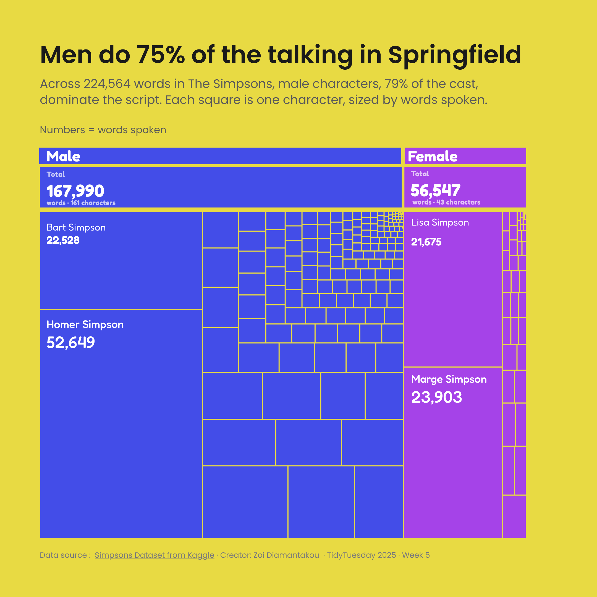
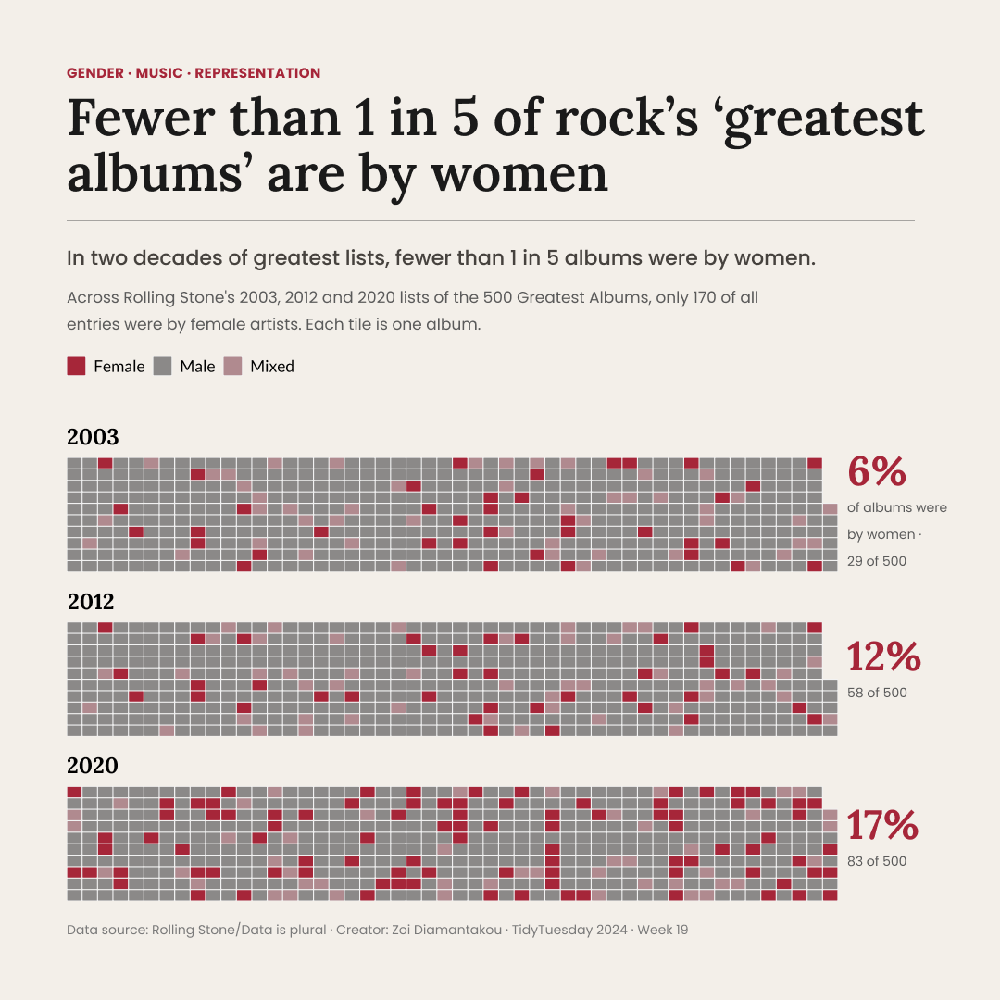
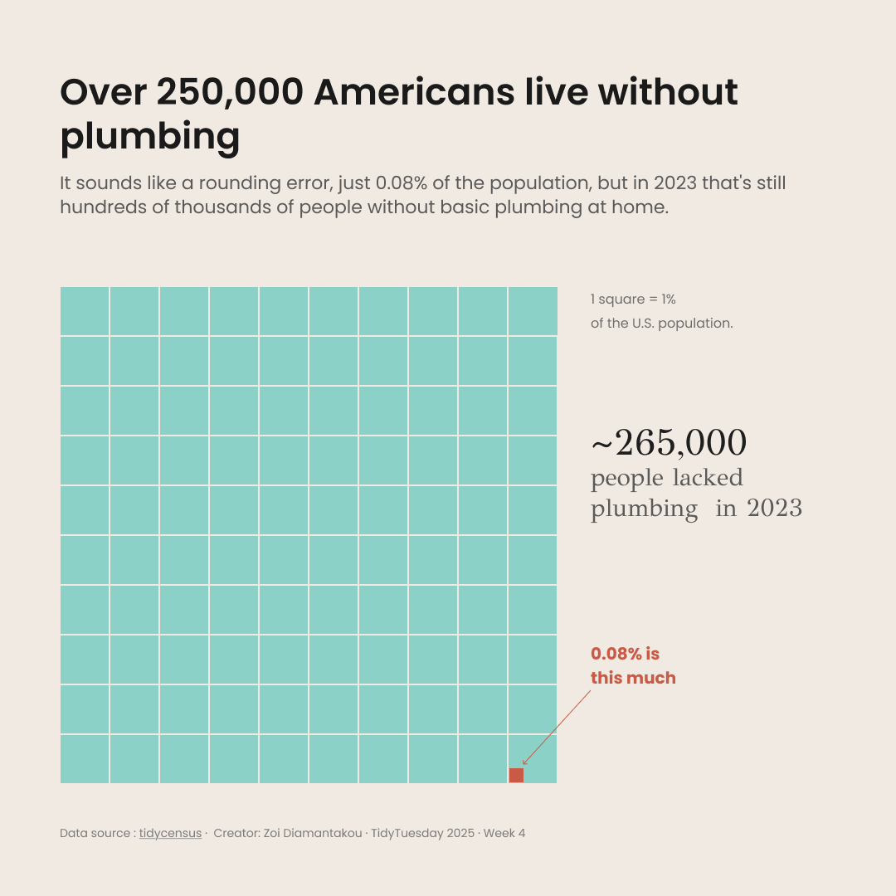
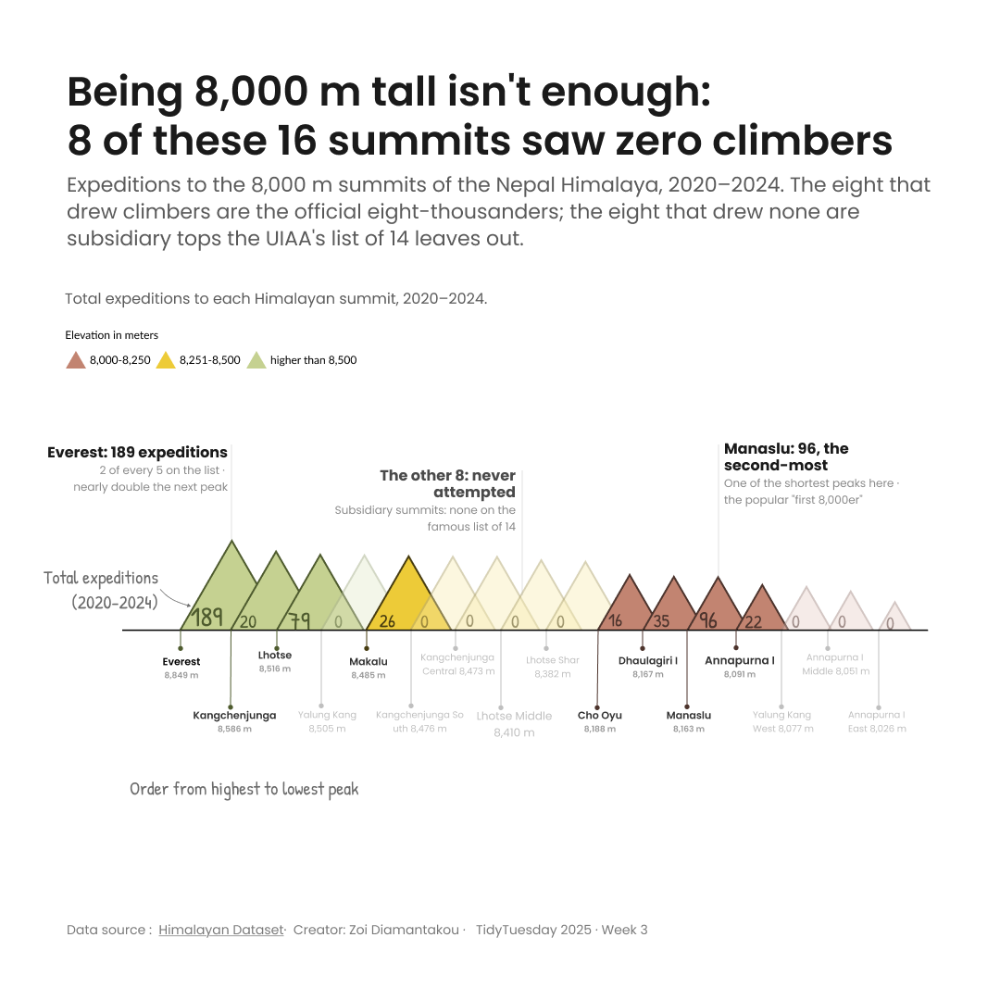
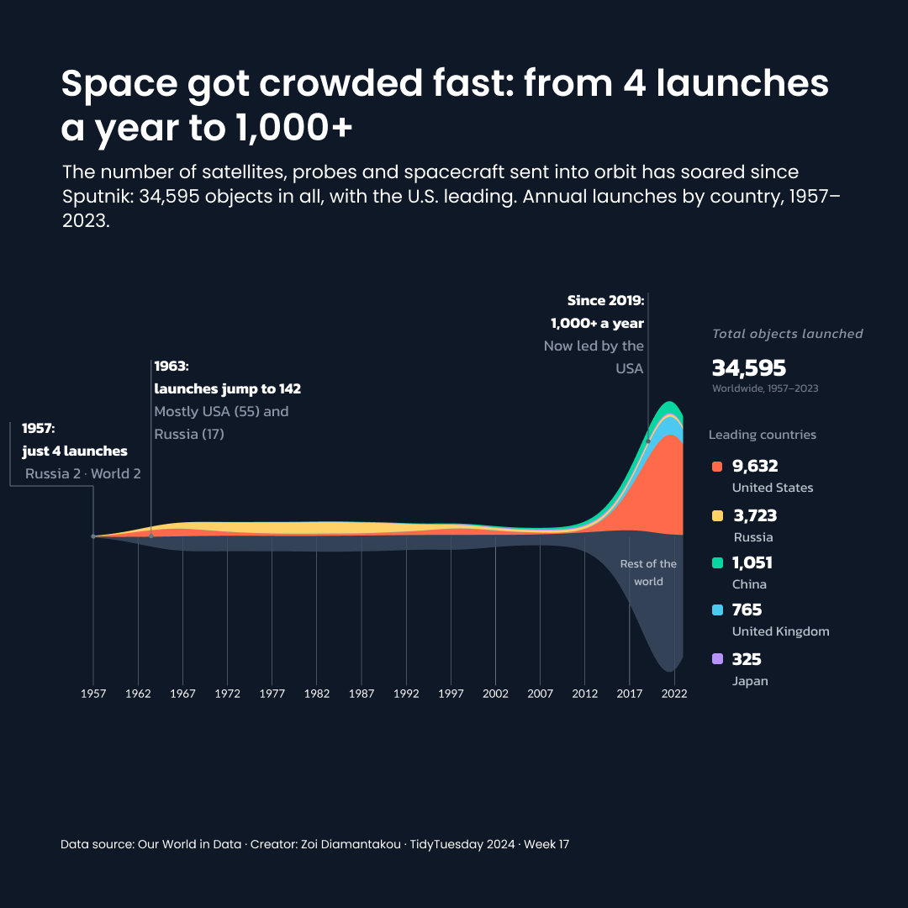

# Chart catalogue

Every chart I've made for [#TidyTuesday](https://github.com/rfordatascience/tidytuesday) since 2023, **68 in total**, grouped by topic. Click a picture to open it full size, or **code** to see the R script.

⭐ marks the charts featured on the [main page](README.md).

## Contents

- [Equality & representation](#equality--representation) (9)
- [Rights, governance & displacement](#rights-governance--displacement) (8)
- [Health, education & living conditions](#health-education--living-conditions) (5)
- [Environment & science](#environment--science) (10)
- [Culture & entertainment](#culture--entertainment) (16)
- [Sport, food & everyday life](#sport-food--everyday-life) (12)
- [R & the data community](#r--the-data-community) (8)

---

## Equality & representation

Who gets counted, heard and included.

<table>
<tr><th width="190">Preview</th><th width="500">Chart</th><th width="120">Week</th><th width="80">Code</th></tr>
<tr><td></td><td><b>Simpsons: who does the talking</b> ⭐</td><td>2025 · W5</td><td><a href="https://github.com/ZoiDiama/My-tidytuesday-projects/tree/main/Code%202025">code</a></td></tr>
<tr><td></td><td><b>Du Bois Visualization Challenge 2024</b></td><td>2024 · W14</td><td><a href="https://github.com/ZoiDiama/My-tidytuesday-projects/blob/d7d51bd24dab23a1d830bd831b0dbda36a3d9d99/Code%202024/Week%2014#L1">code</a></td></tr>
<tr><td></td><td><b>Rolling Stone's greatest albums</b> ⭐</td><td>2024 · W19</td><td><a href="https://github.com/ZoiDiama/My-tidytuesday-projects/blob/4adae83b6a904462068498f2e1ceeac5d9ee8341/Code%202024/week%2019#L1">code</a></td></tr>
<tr><td></td><td><b>Campus Pride Index</b></td><td>2024 · W24</td><td><a href="https://github.com/ZoiDiama/My-tidytuesday-projects/blob/aa94d605dc46bf26437b1c8395bd5df0f1b54477/Code%202024/Week%2024#L1-L113">code</a></td></tr>
<tr><td></td><td><b>English Women's Football</b></td><td>2024 · W29</td><td><a href="https://github.com/ZoiDiama/My-tidytuesday-projects/blob/097f7714eb82b8ebafc2bdeb2272d903042ac5a2/Code%202024/Week%2029#L1-L114">code</a></td></tr>
<tr><td></td><td><b>Economic Diversity and Student Outcomes</b></td><td>2024 · W37</td><td><a href="https://github.com/ZoiDiama/My-tidytuesday-projects/blob/25c6a08ae2cd5e09e90cc671f7f333cee4c2218a/Code%202024/Week%2037#L1">code</a></td></tr>
<tr><td></td><td><b>GPT detectors are biased against non-native English writers</b></td><td>2023 · W29</td><td><a href="https://github.com/ZoiDiama/My-tidytuesday-projects/blob/6af2a7e0af3014c1680eeb3b41d50830f453f767/Code/2023/Week29_GPT_detectors#L1-L33">code</a></td></tr>
<tr><td></td><td><b>Union membership in the United States</b></td><td>2023 · W36</td><td><a href="https://github.com/ZoiDiama/My-tidytuesday-projects/blob/e3e0516b72bc8f910db52a65ab83c4960ae77296/Code/2023/Week36#L1-L56">code</a></td></tr>
<tr><td></td><td><b>R-Ladies Chapter Events</b></td><td>2023 · W47</td><td><a href="https://github.com/ZoiDiama/My-tidytuesday-projects/blob/40cc4b705016af1cc0df352ec898fa3ef69f8f06/Code/2023/Week_47#L1-L99">code</a></td></tr>
</table>

[↑ Back to contents](#contents)

---

## Rights, governance & displacement

Forced displacement, elections, public institutions and the law.

<table>
<tr><th width="190">Preview</th><th width="500">Chart</th><th width="120">Week</th><th width="80">Code</th></tr>
<tr><td></td><td><b>US Polling Places 2012-2020</b></td><td>2024 · W3</td><td><a href="https://github.com/ZoiDiama/My-tidytuesday-projects/blob/d8a5766568746806823ed1b87035e3ffac8989c7/Code%202024/Week%203#L1-L125">code</a></td></tr>
<tr><td></td><td><b>Fiscal Sponsors</b></td><td>2024 · W11</td><td><a href="https://github.com/ZoiDiama/My-tidytuesday-projects/blob/a3c5c45bf840b70d0211d0598a9ca383fee054b7/Code%202024/Week%2011#L1-L105">code</a></td></tr>
<tr><td></td><td><b>Worldwide Bureaucracy Indicators</b></td><td>2024 · W18</td><td><a href="https://github.com/ZoiDiama/My-tidytuesday-projects/blob/a268923887c2e0dbb4c74e436270bacab9cd7dcf/Code%202024/Week%2018#L1-L120">code</a></td></tr>
<tr><td></td><td><b>The CIA World Factbook</b></td><td>2024 · W43</td><td><a href="https://github.com/ZoiDiama/My-tidytuesday-projects/blob/0346d4f5c05faafd9dd10a4633c0f8d31551b550/Code%202024/Week%2043#L1-L353">code</a></td></tr>
<tr><td></td><td><b>Refugees</b></td><td>2023 · W34</td><td><a href="https://github.com/ZoiDiama/My-tidytuesday-projects/blob/c0dee5214455870cac4ce6eaad1dafe756ffb145/Code/2023/Week%2034#L1-L114">code</a></td></tr>
<tr><td></td><td><b>Fair use</b></td><td>2023 · W35</td><td><a href="https://github.com/ZoiDiama/My-tidytuesday-projects/blob/ffc7325327f91322c7b4dbc7fbee6c095bb7325f/Code/2023/Week%2035#L1-L78">code</a></td></tr>
<tr><td></td><td><b>US Government Grant Opportunities</b></td><td>2023 · W40</td><td><a href="https://github.com/ZoiDiama/My-tidytuesday-projects/blob/af8e13c0940b29831ed075fb7399c757a2330d05/Code/2023/Week%2040#L1-L225">code</a></td></tr>
<tr><td></td><td><b>US House Election Results</b></td><td>2023 · W45</td><td><a href="https://github.com/ZoiDiama/My-tidytuesday-projects/blob/710960a0d90b446587f63b8278db370592f36ac9/Code/2023/Week_45#L1-L109">code</a></td></tr>
</table>

[↑ Back to contents](#contents)

---

## Health, education & living conditions

How people live, learn and spend their days.

<table>
<tr><th width="190">Preview</th><th width="500">Chart</th><th width="120">Week</th><th width="80">Code</th></tr>
<tr><td></td><td><b>Water insecurity: Americans without plumbing</b> ⭐</td><td>2025 · W4</td><td><a href="https://github.com/ZoiDiama/My-tidytuesday-projects/blob/31300ca1f786211ba6e467f92970073afea1bbdf/Code%202025/Week%204#L1">code</a></td></tr>
<tr><td></td><td><b>Educational attainment of young people in English towns</b></td><td>2024 · W4</td><td><a href="https://github.com/ZoiDiama/My-tidytuesday-projects/blob/64db00486dd77f856422b0809e53fbfbd246e4a2/Code%202024/Week%204#L1-L103">code</a></td></tr>
<tr><td></td><td><b>Scurvy</b></td><td>2023 · W30</td><td><a href="https://github.com/ZoiDiama/My-tidytuesday-projects/blob/7daa9b29c8756a2f1d5c6863d426c17231363a8c/Code/2023/Week30_Scurvy#L1C1-L1C1">code</a></td></tr>
<tr><td></td><td><b>The Global Human Day</b></td><td>2023 · W37</td><td><a href="https://github.com/ZoiDiama/My-tidytuesday-projects/blob/1a44f946eedf2792eb651dc56ea671d34e92d1cb/Code/2023/Week%2037#L1-L54">code</a></td></tr>
<tr><td></td><td><b>Life Expectancy</b></td><td>2023 · W49</td><td><a href="https://github.com/ZoiDiama/My-tidytuesday-projects/blob/bc38a04d5ce5cd5eda059e300d0c3e6268640ff1/Code/2023/Week%2049#L1-L206">code</a></td></tr>
</table>

[↑ Back to contents](#contents)

---

## Environment & science

Climate, nature, space and the physical world.

<table>
<tr><th width="190">Preview</th><th width="500">Chart</th><th width="120">Week</th><th width="80">Code</th></tr>
<tr><td></td><td><b>Himalayan mountaineering expeditions</b> ⭐</td><td>2025 · W3</td><td><a href="https://github.com/ZoiDiama/My-tidytuesday-projects/blob/c6a11fc9464669cf8d3a5eccb5b23297403243fa/Code%202025/Week%203#L1">code</a></td></tr>
<tr><td></td><td><b>Groundhog predictions</b></td><td>2024 · W5</td><td><a href="https://github.com/ZoiDiama/My-tidytuesday-projects/blob/ef098be27a5f5c4acf24f23f826bbb86e62c429f/Code%202024/Week%205#L1-L131">code</a></td></tr>
<tr><td></td><td><b>Trash Wheel Collection Data</b></td><td>2024 · W10</td><td><a href="https://github.com/ZoiDiama/My-tidytuesday-projects/blob/3f0266042d104c20fabcf24a6c7169be5d9c9a45/Code%202024/Week%2010#L1-L139">code</a></td></tr>
<tr><td></td><td><b>2023 & 2024 US Solar Eclipses</b></td><td>2024 · W15</td><td><a href="https://github.com/ZoiDiama/My-tidytuesday-projects/blob/46091eedd4006e021069708f9b899fe50fd2271a/Code%202024/Week%2015#L1">code</a></td></tr>
<tr><td></td><td><b>Objects Launched into Space</b> ⭐</td><td>2024 · W17</td><td><a href="https://github.com/ZoiDiama/My-tidytuesday-projects/blob/184db5c457c1acbecae3d535969d114b2953d04b/Code%202024/Week%2017#L1-L114">code</a></td></tr>
<tr><td></td><td><b>Carbon Majors Emissions Data</b></td><td>2024 · W21</td><td><a href="https://github.com/ZoiDiama/My-tidytuesday-projects/blob/b63fbd144ad42467cc1ca117154806f1c6e917bc/Code%202024/Week%2021#L1-L122">code</a></td></tr>
<tr><td></td><td><b>Lisa's Vegetable Garden Data</b></td><td>2024 · W22</td><td><a href="https://github.com/ZoiDiama/My-tidytuesday-projects/blob/10c1df73bad064ae65d907baddf811b8052eaa6c/Code%202024/Week%2022#L1-L89">code</a></td></tr>
<tr><td></td><td><b>National Park Species</b></td><td>2024 · W41</td><td><a href="https://github.com/ZoiDiama/My-tidytuesday-projects/blob/7c9f06ace9684ca1740b9d0635c9624898230c9f/Code%202024/Week%2041#L1-L130">code</a></td></tr>
<tr><td></td><td><b>Southern Resident Killer Whale Encounters</b></td><td>2024 · W42</td><td><a href="https://github.com/ZoiDiama/My-tidytuesday-projects/blob/61818796a0bb99468d96e452befa590dfe9e33cb/Code%202024/Week%2042#L1">code</a></td></tr>
<tr><td></td><td><b>Global Surface Temperatures</b> ⭐</td><td>2023 · W28</td><td><a href="https://github.com/ZoiDiama/My-tidytuesday-projects/blob/4af0c90acb7b5255ed37e3b07756bb30bed0bf0a/Code/2023/Week28Global%20Surface%20Temperatures#L1C1-L80C4">code</a></td></tr>
</table>

[↑ Back to contents](#contents)

---

## Culture & entertainment

Books, film, TV, music and history.

<table>
<tr><th width="190">Preview</th><th width="500">Chart</th><th width="120">Week</th><th width="80">Code</th></tr>
<tr><td></td><td><b>UNESCO World Heritage sites</b></td><td>2024 · W6</td><td><a href="https://github.com/ZoiDiama/My-tidytuesday-projects/blob/86d5c3e78cde7efd6646e7a29cd185675f073cb8/Code%202024/Week%206#L1-L106">code</a></td></tr>
<tr><td></td><td><b>American Idol</b></td><td>2024 · W30</td><td><a href="https://github.com/ZoiDiama/My-tidytuesday-projects/blob/a52f9a85ba62a03fd181332e401e49c8e6933c23/Code%202024/Week%2030#L1-L114">code</a></td></tr>
<tr><td></td><td><b>Summer Movies</b></td><td>2024 · W31</td><td><a href="https://github.com/ZoiDiama/My-tidytuesday-projects/blob/a47d41ade715d330f0535ab138a9fa6c91b4fe17/Code%202024/Week%2031#L1-L111">code</a></td></tr>
<tr><td></td><td><b>World's fairs</b></td><td>2024 · W33</td><td><a href="https://github.com/ZoiDiama/My-tidytuesday-projects/blob/6b5a4aab16044c77c946ca9d6e3face376fca8c2/Code%202024/Week%2033#L1-L99">code</a></td></tr>
<tr><td></td><td><b>English Monarchs and Marriages</b></td><td>2024 · W34</td><td><a href="https://github.com/ZoiDiama/My-tidytuesday-projects/blob/2bf94a1792686da56304532f99218a44787afdef/Code%202024/Week%2034#L1-L138">code</a></td></tr>
<tr><td></td><td><b>The Power Rangers Franchise</b></td><td>2024 · W35</td><td><a href="https://github.com/ZoiDiama/My-tidytuesday-projects/blob/a96f5bd493cea56cad33739e1710ac2ba18820d6/Code%202024/Week%2035#L1">code</a></td></tr>
<tr><td></td><td><b>Shakespeare dialogue</b> ⭐</td><td>2024 · W38</td><td><a href="https://github.com/ZoiDiama/My-tidytuesday-projects/blob/2e3f3a081a264386db85afcae7f0d68e459c25c0/Code%202024/Week%2038#L1-L138">code</a></td></tr>
<tr><td></td><td><b>Monster Movies</b></td><td>2024 · W44</td><td><a href="https://github.com/ZoiDiama/My-tidytuesday-projects/blob/87f78655143e131f5bfdae880935da727f1b482d/Code%202024/Week%2044#L1">code</a></td></tr>
<tr><td></td><td><b>Hot Ones Episodes</b></td><td>2023 · W32</td><td><a href="https://github.com/ZoiDiama/My-tidytuesday-projects/blob/13dc335ddcf54d3f0f1b86576b0bf70f537cebcf/Code/2023/Week32#L1-L77">code</a></td></tr>
<tr><td></td><td><b>Roy Kent's swear count</b></td><td>2023 · W39</td><td><a href="https://github.com/ZoiDiama/My-tidytuesday-projects/blob/4fe4900d1905b7c44c82a0a5f130e76c474cef55/Code/2023/Week%2039#L1-L121">code</a></td></tr>
<tr><td></td><td><b>Haunted Places in the United States</b></td><td>2023 · W41</td><td><a href="https://github.com/ZoiDiama/My-tidytuesday-projects/blob/709119e62b0e3bc35237645ae7b1a69fc809203f/Code/2023/Week%2041#L1-L104">code</a></td></tr>
<tr><td></td><td><b>Taylor Swift songs</b></td><td>2023 · W42</td><td><a href="https://github.com/ZoiDiama/My-tidytuesday-projects/tree/main/Code/2023">code</a></td></tr>
<tr><td></td><td><b>Horror Legends</b></td><td>2023 · W44</td><td><a href="https://github.com/ZoiDiama/My-tidytuesday-projects/blob/2bf0d72551409886a1896a4630b7e03d93e2baeb/Code/2023/Week_44#L1-L112">code</a></td></tr>
<tr><td></td><td><b>Doctor Who Episodes</b></td><td>2023 · W48</td><td><a href="https://github.com/ZoiDiama/My-tidytuesday-projects/blob/ed0ed78637ff67ee5d48e5e85db7b775f7d33863/Code/2023/Week%2048#L1-L88">code</a></td></tr>
<tr><td></td><td><b>Holiday movies</b></td><td>2023 · W50</td><td><a href="https://github.com/ZoiDiama/My-tidytuesday-projects/blob/6da4d041fa6465cb4babbfcef87baacf722c6526/Code/2023/Week%2050#L1-L70">code</a></td></tr>
<tr><td></td><td><b>Holiday episodes</b></td><td>2023 · W51</td><td><a href="https://github.com/ZoiDiama/My-tidytuesday-projects/blob/f9b056a141896d82d1989c40e32df7c31e016440/Code/2023/Week%2051#L1-L113">code</a></td></tr>
</table>

[↑ Back to contents](#contents)

---

## Sport, food & everyday life

Games, competitions, food and the calendar.

<table>
<tr><th width="190">Preview</th><th width="500">Chart</th><th width="120">Week</th><th width="80">Code</th></tr>
<tr><td></td><td><b>Bring your own data to start the year!</b></td><td>2025 · W1</td><td><a href="https://github.com/ZoiDiama/My-tidytuesday-projects/blob/6fe630360628c9b56dcd543ce5308ffaaff18055/Code%202025/Week%201#L1">code</a></td></tr>
<tr><td></td><td><b>Canadian Hockey Players</b></td><td>2024 · W2</td><td><a href="https://github.com/ZoiDiama/My-tidytuesday-projects/blob/aa0cd9959aba935d81078f7819e115eda1b68644/Code%202024/Week%202#L1-L112">code</a></td></tr>
<tr><td></td><td><b>Valentine's Day Consumer Data</b></td><td>2024 · W7</td><td><a href="https://github.com/ZoiDiama/My-tidytuesday-projects/blob/3bd5adfb5a71c7e8fc2dc3425116f6b2944ea5ba/Code%202024/Week%207#L1-L118">code</a></td></tr>
<tr><td></td><td><b>Leap Day</b></td><td>2024 · W9</td><td><a href="https://github.com/ZoiDiama/My-tidytuesday-projects/blob/d937c79cf26a4108c5e1fcfb797fb22d46a5de8b/Code%202024/Week%209#L1-L125">code</a></td></tr>
<tr><td></td><td><b>The Great American Coffee Taste Test</b></td><td>2024 · W20</td><td><a href="https://github.com/ZoiDiama/My-tidytuesday-projects/blob/4e3a9dde83fdf102f7e855d8844681f7740e924b/Code%202024/Week%2020#L1-L121">code</a></td></tr>
<tr><td></td><td><b>Cheese</b></td><td>2024 · W23</td><td><a href="https://github.com/ZoiDiama/My-tidytuesday-projects/blob/6bf695c266dc37f3208916cc440ac46a88c36e23/Code%202024/Week%2023#L1">code</a></td></tr>
<tr><td></td><td><b>US federal holidays</b></td><td>2024 · W25</td><td><a href="https://github.com/ZoiDiama/My-tidytuesday-projects/tree/main/Code%202024">code</a></td></tr>
<tr><td></td><td><b>Olympic Medals</b></td><td>2024 · W32</td><td><a href="https://github.com/ZoiDiama/My-tidytuesday-projects/blob/4dd30f6505e11e8536958c19895670f7029c17b0/Code%202024/Week%2032#L1">code</a></td></tr>
<tr><td></td><td><b>International Mathematical Olympiad (IMO) Data</b></td><td>2024 · W39</td><td><a href="https://github.com/ZoiDiama/My-tidytuesday-projects/blob/4b9cd1d82ff4edb40bda0e71898c9627caab4406/Code%202024/Week%2039#L1-L86">code</a></td></tr>
<tr><td></td><td><b>Chess Game Dataset (Lichess)</b></td><td>2024 · W40</td><td><a href="https://github.com/ZoiDiama/My-tidytuesday-projects/blob/3b42a9e6d9962d5c98c37605f2aa6887f3b912be/Code%202024/Week%2040#L1-L130">code</a></td></tr>
<tr><td></td><td><b>US States</b></td><td>2023 · W31</td><td><a href="https://github.com/ZoiDiama/My-tidytuesday-projects/blob/6be7b5fb61a83f814f43331f1c10a063c7d8fd83/Code/2023/Week31#L1-L169">code</a></td></tr>
<tr><td></td><td><b>Diwali Sales Data</b></td><td>2023 · W46</td><td><a href="https://github.com/ZoiDiama/My-tidytuesday-projects/blob/19fcb485eabf89799b0f6dcf633dc368ec0dfc24/Code/2023/Week_46#L1-L110">code</a></td></tr>
</table>

[↑ Back to contents](#contents)

---

## R & the data community

Charts about the tools and people behind open data.

<table>
<tr><th width="190">Preview</th><th width="500">Chart</th><th width="120">Week</th><th width="80">Code</th></tr>
<tr><td></td><td><b>posit::conf talks</b></td><td>2025 · W2</td><td><a href="https://github.com/ZoiDiama/My-tidytuesday-projects/blob/7b0e3c0a4277cbda1b0c4ad1f4cf51a9aa9193eb/Code%202025/Week%202#L1">code</a></td></tr>
<tr><td></td><td><b>R Consortium ISC Grants</b></td><td>2024 · W8</td><td><a href="https://github.com/ZoiDiama/My-tidytuesday-projects/blob/5beb4b3fa38b9d99f2f42c8ab63d893b6c22f335/Code%202024/Week%208#L1">code</a></td></tr>
<tr><td></td><td><b>tidyRainbow Datasets</b></td><td>2024 · W26</td><td><a href="https://github.com/ZoiDiama/My-tidytuesday-projects/blob/595a22cec50665f5d0eaf01a3eaf14423e241eb8/Code%202024/Week%2026#L1-L136">code</a></td></tr>
<tr><td></td><td><b>TidyTuesday Datasets</b></td><td>2024 · W27</td><td><a href="https://github.com/ZoiDiama/My-tidytuesday-projects/blob/8a59cab2c8736ff4635e3a9c3bed19ddbe63cfd8/Code%202024/Week%2027#L1">code</a></td></tr>
<tr><td></td><td><b>David Robinson's TidyTuesday Functions</b></td><td>2024 · W28</td><td><a href="https://github.com/ZoiDiama/My-tidytuesday-projects/blob/271d3a0c35e28b9d1f05bf9aa0e260486f00ce85/Code%202024/Week%2028#L1">code</a></td></tr>
<tr><td></td><td><b>Stack Overflow Annual Developer Survey 2024</b></td><td>2024 · W36</td><td><a href="https://github.com/ZoiDiama/My-tidytuesday-projects/blob/a17150faa22ad2138433047492754555f7a448da/Code%202024/Week%2036#L1-L129">code</a></td></tr>
<tr><td></td><td><b>Spam emails</b></td><td>2023 · W33</td><td><a href="https://github.com/ZoiDiama/My-tidytuesday-projects/blob/4c8a235621e20b1d3b544c53abe8c451af2217ce/Code/2023/Week%2033#L1-L53">code</a></td></tr>
<tr><td></td><td><b>Structure of R packages</b></td><td>2023 · W52</td><td><a href="https://github.com/ZoiDiama/My-tidytuesday-projects/blob/9b5737a31939ec63b1dce6bab338afc334b51264/Code/2023/Week%2052#L1-L105">code</a></td></tr>
</table>

[↑ Back to contents](#contents)

---

## By year

| Year | Charts | Focus |
|---|---|---|
| 2023 | 23 | My first year: learning ggplot2 and trying different chart types |
| 2024 | 40 | More attention to typography, colour and final design in Figma |
| 2025 | 5 | Headline-first charts: every title states the finding |

