# Chart catalogue

Every chart I've made for [#TidyTuesday](https://github.com/rfordatascience/tidytuesday) since 2023, **67 in total**, grouped by topic and listed newest first. Each chart has its key finding and the chart type used. Click a picture to open it full size, the **week** to see the TidyTuesday dataset, or **code** to see the R script.

⭐ marks the charts featured on the [main page](README.md).

## Contents

- [Equality & representation](#equality--representation) (6)
- [Rights, governance & displacement](#rights-governance--displacement) (9)
- [Health, education & living conditions](#health-education--living-conditions) (8)
- [Environment & science](#environment--science) (10)
- [Culture & entertainment](#culture--entertainment) (16)
- [Sport, food & everyday life](#sport-food--everyday-life) (11)
- [R & the data community](#r--the-data-community) (7)

---

## Equality & representation

Who gets counted, heard and included.

<table>
<tr><th width="190">Preview</th><th width="500">Chart</th><th width="120">Week</th><th width="80">Code</th></tr>
<tr><td></td><td><b>Simpsons: who does the talking</b> ⭐ Men do 75% of the talking in The Simpsons' Springfield. <i>Treemap</i></td><td><a href="https://github.com/rfordatascience/tidytuesday/tree/main/data/2025/2025-02-04">2025 · W5</a></td><td><a href="https://github.com/ZoiDiama/My-tidytuesday-projects/blob/main/Code%202025/Week%205">code</a></td></tr>
<tr><td><a href="charts/2024_w37.png">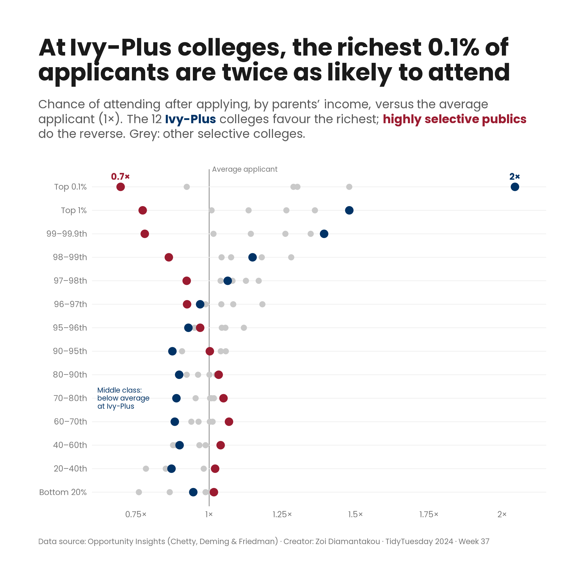</a></td><td><b>Economic Diversity and Student Outcomes</b> At Ivy-Plus colleges, the richest 0.1% of applicants are twice as likely to attend. <i>Dot plot</i></td><td><a href="https://github.com/rfordatascience/tidytuesday/tree/main/data/2024/2024-09-10">2024 · W37</a></td><td><a href="https://github.com/ZoiDiama/My-tidytuesday-projects/blob/main/Code%202024/Week%2037">code</a></td></tr>
<tr><td><a href="charts/2024_w26.png">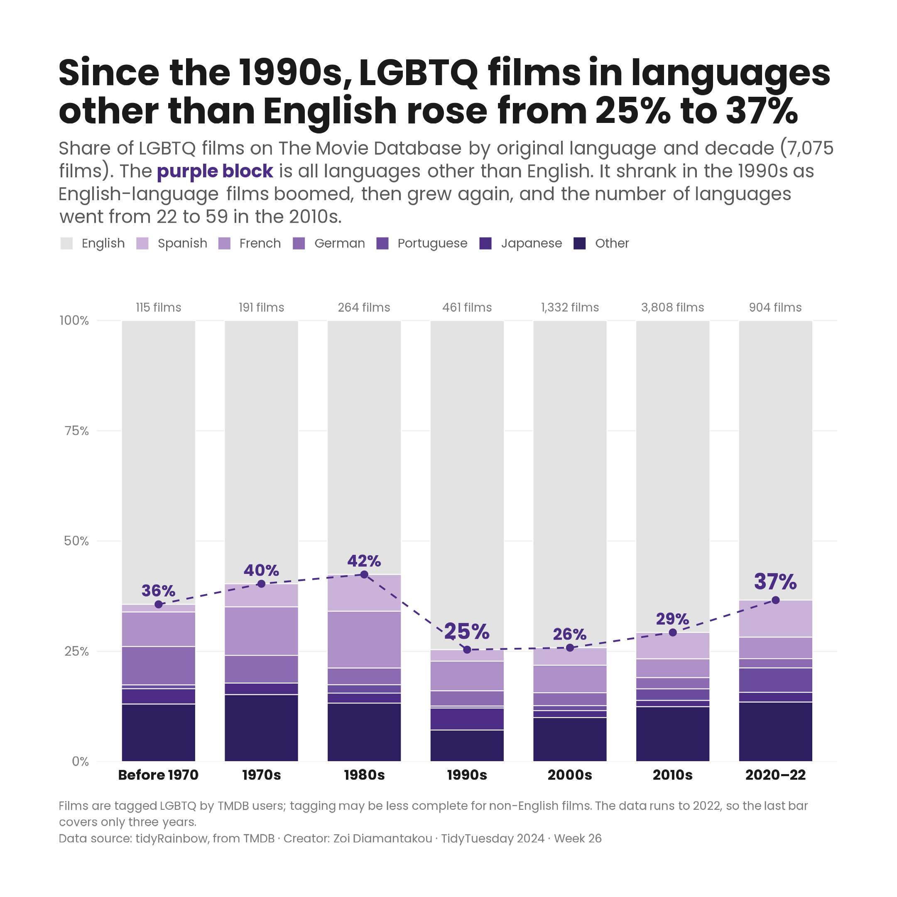</a></td><td><b>tidyRainbow Datasets</b> Since the 1990s, LGBTQ films in languages other than English rose from 25% to 37%. <i>100% stacked bar chart</i></td><td><a href="https://github.com/rfordatascience/tidytuesday/tree/main/data/2024/2024-06-25">2024 · W26</a></td><td><a href="https://github.com/ZoiDiama/My-tidytuesday-projects/blob/main/Code%202024/Week%2026">code</a></td></tr>
<tr><td><a href="charts/2024_w24.png">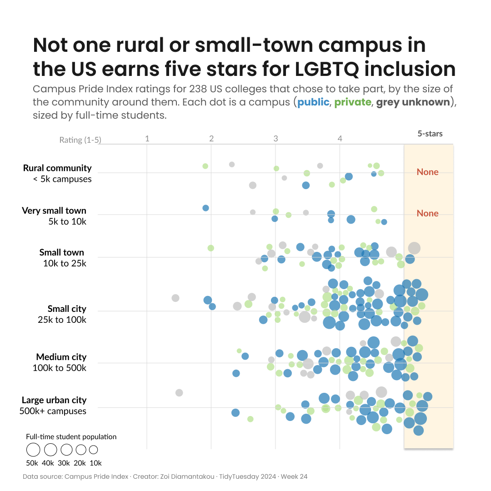</a></td><td><b>Campus Pride Index</b> Not one rural or small-town US campus earns five stars for LGBTQ inclusion. <i>Bubble dot plot</i></td><td><a href="https://github.com/rfordatascience/tidytuesday/tree/main/data/2024/2024-06-11">2024 · W24</a></td><td><a href="https://github.com/ZoiDiama/My-tidytuesday-projects/blob/main/Code%202024/Week%2024">code</a></td></tr>
<tr><td></td><td><b>Rolling Stone's greatest albums</b> ⭐ Fewer than 1 in 5 of rock's 'greatest albums' are by women. <i>Waffle chart</i></td><td><a href="https://github.com/rfordatascience/tidytuesday/tree/main/data/2024/2024-05-07">2024 · W19</a></td><td><a href="https://github.com/ZoiDiama/My-tidytuesday-projects/blob/main/Code%202024/week%2019">code</a></td></tr>
<tr><td><a href="charts/2023_w29.png">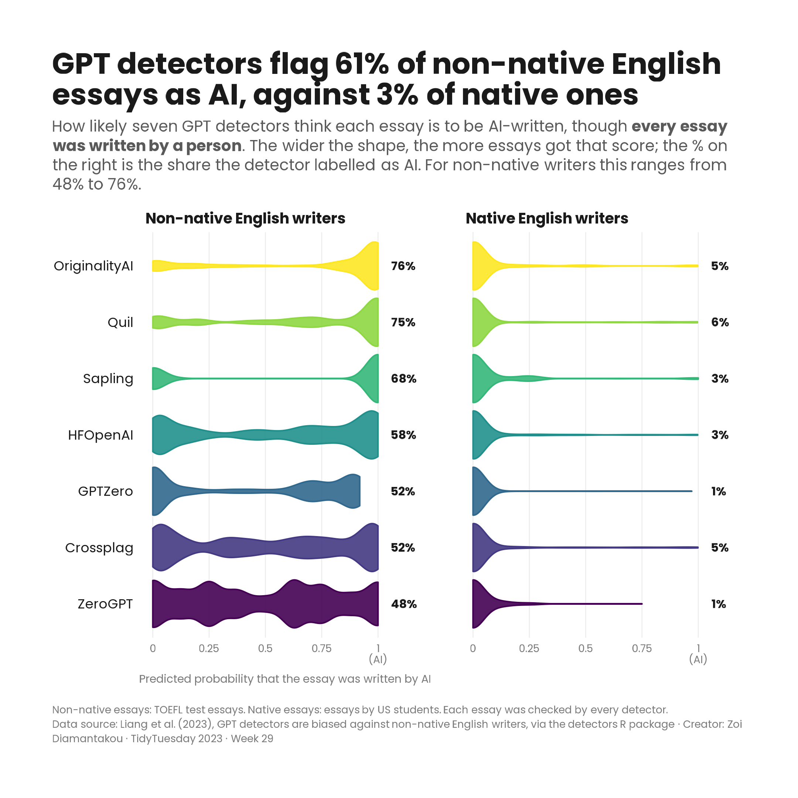</a></td><td><b>GPT detectors are biased against non-native English writers</b> GPT detectors flag 61% of non-native English essays as AI, against 3% of native ones. <i>Violin plot</i></td><td><a href="https://github.com/rfordatascience/tidytuesday/tree/main/data/2023/2023-07-18">2023 · W29</a></td><td><a href="https://github.com/ZoiDiama/My-tidytuesday-projects/blob/main/Code/2023/Week29_GPT_detectors">code</a></td></tr>
</table>

[↑ Back to contents](#contents)

---

## Rights, governance & displacement

Forced displacement, elections, public institutions and the law.

<table>
<tr><th width="190">Preview</th><th width="500">Chart</th><th width="120">Week</th><th width="80">Code</th></tr>
<tr><td><a href="charts/2024_w43.png">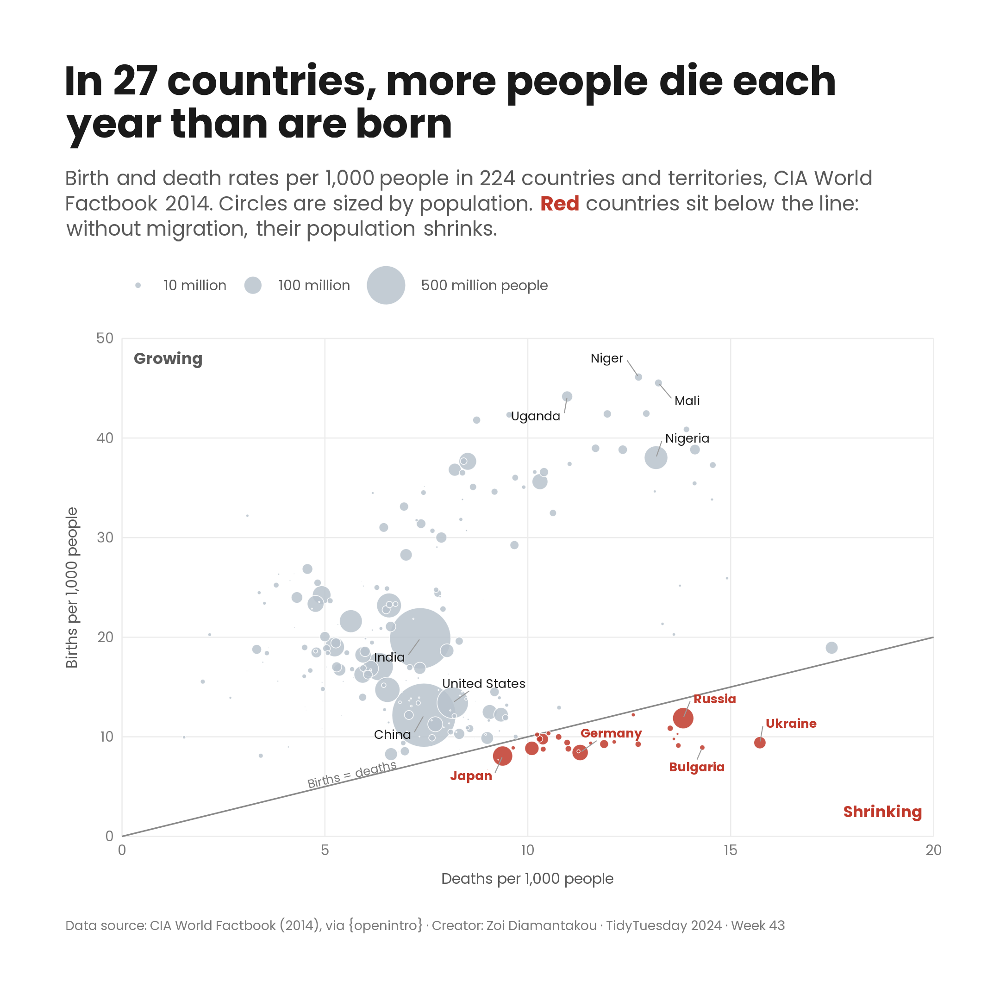</a></td><td><b>The CIA World Factbook</b> In 27 countries, more people die each year than are born. <i>Bubble scatter plot</i></td><td><a href="https://github.com/rfordatascience/tidytuesday/tree/main/data/2024/2024-10-22">2024 · W43</a></td><td><a href="https://github.com/ZoiDiama/My-tidytuesday-projects/blob/main/Code%202024/Week%2043">code</a></td></tr>
<tr><td><a href="charts/2024_w18.png">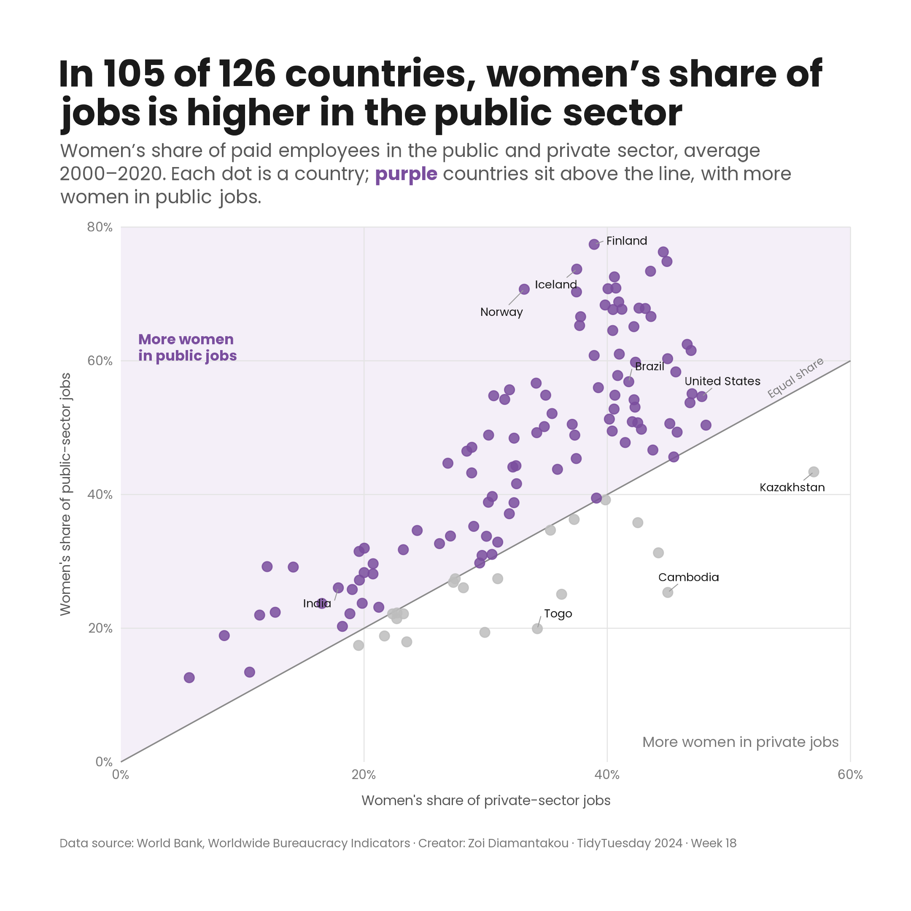</a></td><td><b>Worldwide Bureaucracy Indicators</b> In 105 of 126 countries, women's share of jobs is higher in the public sector. <i>Scatter plot</i></td><td><a href="https://github.com/rfordatascience/tidytuesday/tree/main/data/2024/2024-04-30">2024 · W18</a></td><td><a href="https://github.com/ZoiDiama/My-tidytuesday-projects/blob/main/Code%202024/Week%2018">code</a></td></tr>
<tr><td><a href="charts/2024_w11.png">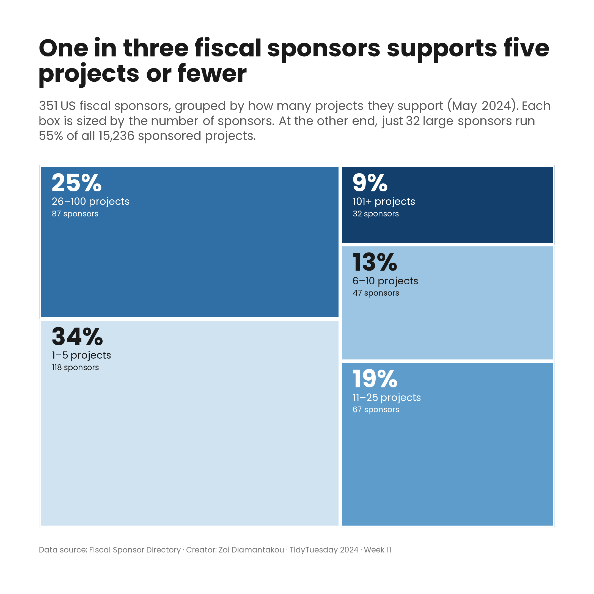</a></td><td><b>Fiscal Sponsors</b> One in three fiscal sponsors supports five projects or fewer. <i>Treemap · treemapify</i></td><td><a href="https://github.com/rfordatascience/tidytuesday/tree/main/data/2024/2024-03-12">2024 · W11</a></td><td><a href="https://github.com/ZoiDiama/My-tidytuesday-projects/blob/main/Code%202024/Week%2011">code</a></td></tr>
<tr><td><a href="charts/2024_w03.png">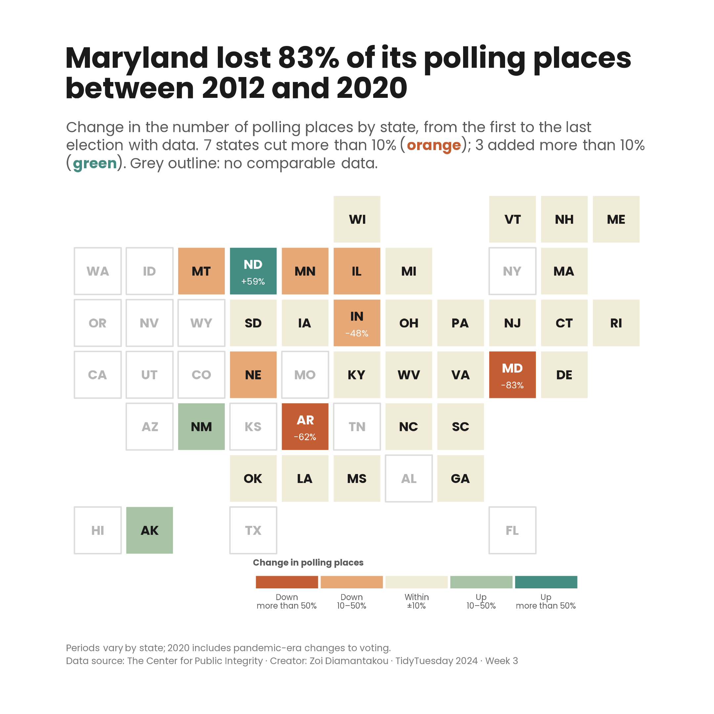</a></td><td><b>US Polling Places 2012-2020</b> Maryland lost 83% of its polling places between 2012 and 2020. <i>Tile grid map</i></td><td><a href="https://github.com/rfordatascience/tidytuesday/tree/main/data/2024/2024-01-16">2024 · W3</a></td><td><a href="https://github.com/ZoiDiama/My-tidytuesday-projects/blob/main/Code%202024/Week%203">code</a></td></tr>
<tr><td><a href="charts/2023_w45.png">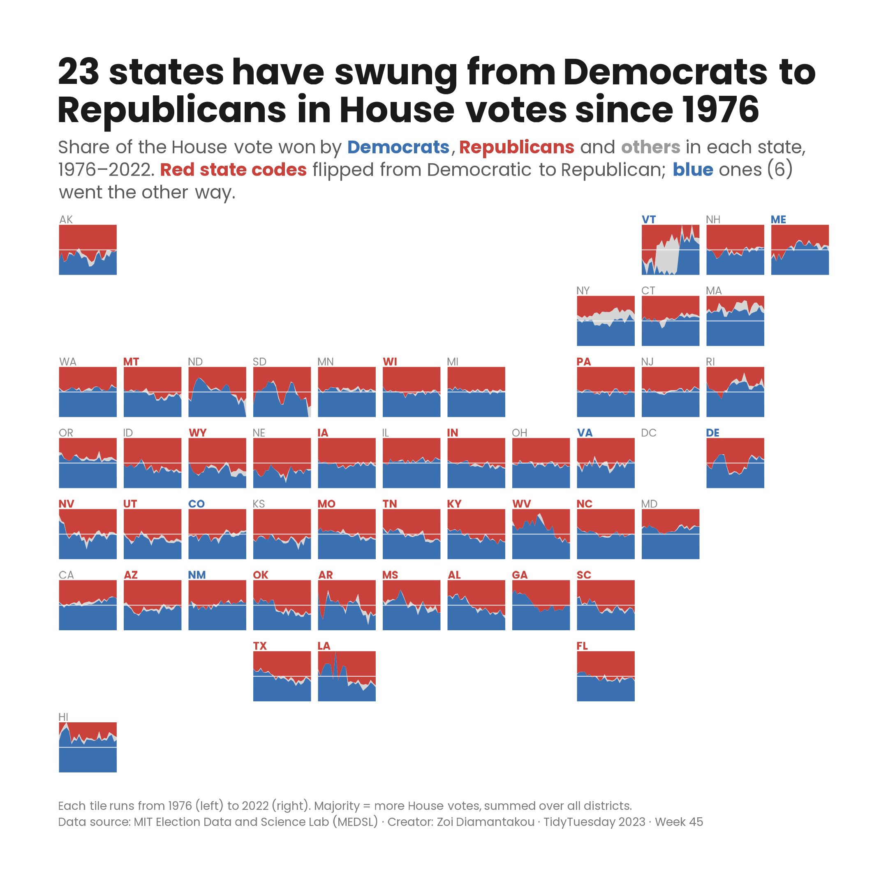</a></td><td><b>US House Election Results</b> 23 states have swung from Democrats to Republicans in House votes since 1976. <i>Area charts on a US state grid · geofacet</i></td><td><a href="https://github.com/rfordatascience/tidytuesday/tree/main/data/2023/2023-11-07">2023 · W45</a></td><td><a href="https://github.com/ZoiDiama/My-tidytuesday-projects/blob/main/Code/2023/Week_45">code</a></td></tr>
<tr><td><a href="charts/2023_w40.png">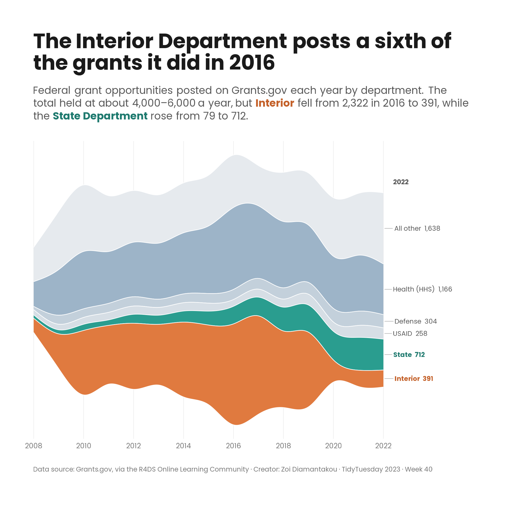</a></td><td><b>US Government Grant Opportunities</b> The US Interior Department posts a sixth of the grants it did in 2016. <i>Stacked area chart</i></td><td><a href="https://github.com/rfordatascience/tidytuesday/tree/main/data/2023/2023-10-03">2023 · W40</a></td><td><a href="https://github.com/ZoiDiama/My-tidytuesday-projects/blob/main/Code/2023/Week%2040">code</a></td></tr>
<tr><td><a href="charts/2023_w36.png">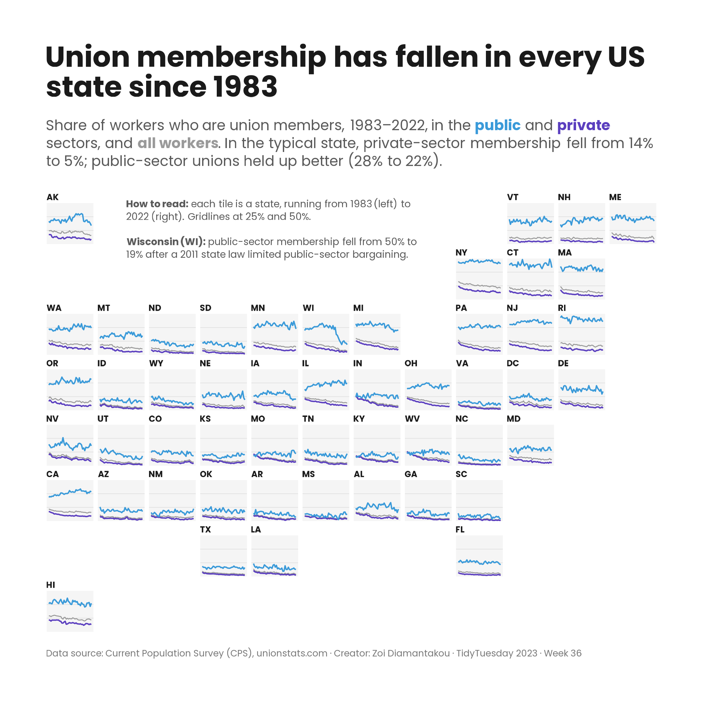</a></td><td><b>Union membership in the United States</b> Union membership has fallen in every US state since 1983. <i>Line charts on a US state grid · geofacet</i></td><td><a href="https://github.com/rfordatascience/tidytuesday/tree/main/data/2023/2023-09-05">2023 · W36</a></td><td><a href="https://github.com/ZoiDiama/My-tidytuesday-projects/blob/main/Code/2023/Week36">code</a></td></tr>
<tr><td><a href="charts/2023_w35.png">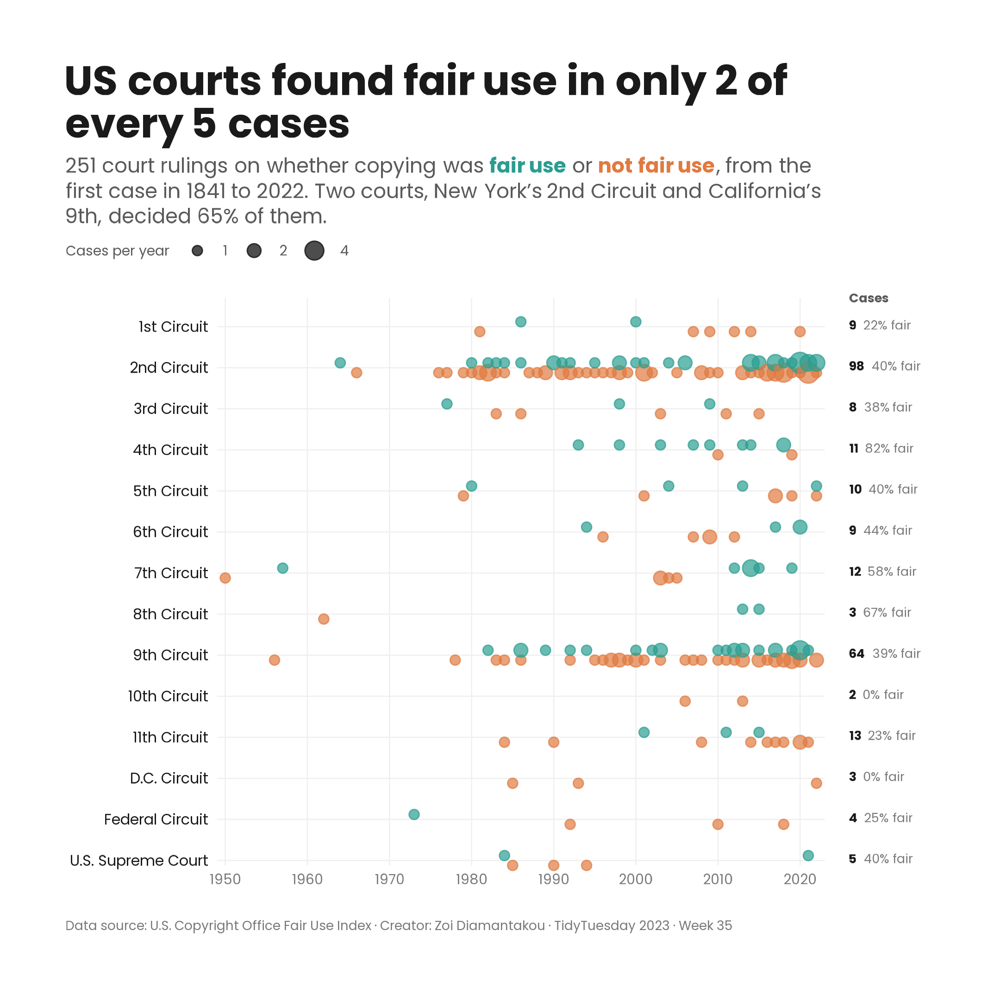</a></td><td><b>Fair use</b> US courts found fair use in only 2 of every 5 cases. <i>Dot timeline</i></td><td><a href="https://github.com/rfordatascience/tidytuesday/tree/main/data/2023/2023-08-29">2023 · W35</a></td><td><a href="https://github.com/ZoiDiama/My-tidytuesday-projects/blob/main/Code/2023/Week%2035">code</a></td></tr>
  
<tr><td><a href="charts/2023_w34.png">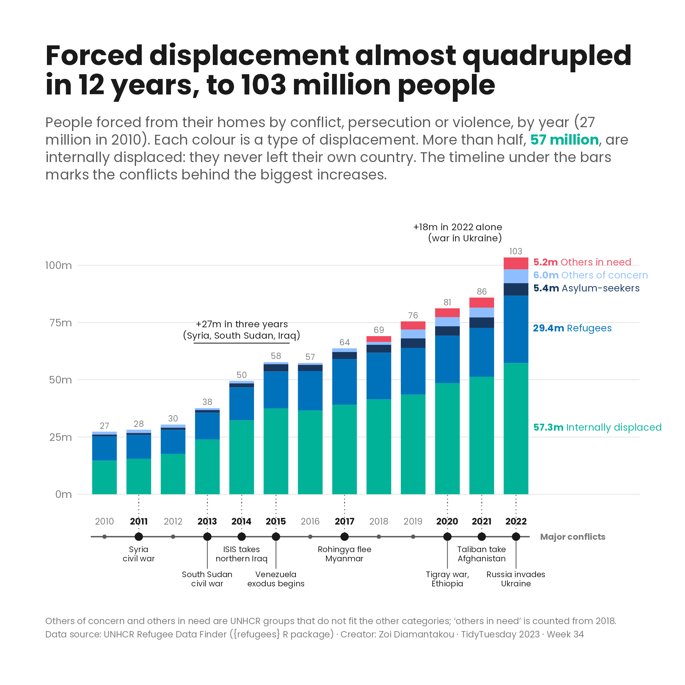</a></td><td><b>Refugees</b> Forced displacement almost quadrupled in 12 years, to 103 million people. <i>Stacked bars with a conflict timeline · UNHCR brand colours · patchwork</i></td><td><a href="https://github.com/rfordatascience/tidytuesday/tree/main/data/2023/2023-08-22">2023 · W34</a></td><td><a href="https://github.com/ZoiDiama/My-tidytuesday-projects/blob/main/Code/2023/Week%2034">code</a></td></tr>
</table>

[↑ Back to contents](#contents)

---

## Health, education & living conditions

How people live, learn and spend their days.

<table>
<tr><th width="190">Preview</th><th width="500">Chart</th><th width="120">Week</th><th width="80">Code</th></tr>
<tr><td></td><td><b>Water insecurity: Americans without plumbing</b> ⭐ Over 250,000 Americans still live without plumbing at home. <i>Proportional square</i></td><td><a href="https://github.com/rfordatascience/tidytuesday/tree/main/data/2025/2025-01-28">2025 · W4</a></td><td><a href="https://github.com/ZoiDiama/My-tidytuesday-projects/blob/main/Code%202025/Week%204">code</a></td></tr>
<tr><td><a href="charts/2025_w1.png">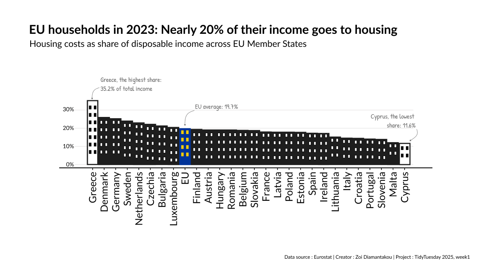</a></td><td><b>Bring your own data to start the year!</b> EU households spend nearly 20% of their income on housing (Eurostat, 2023). <i>Minimal dot-column chart</i></td><td><a href="https://github.com/rfordatascience/tidytuesday/blob/main/data/2025/readme.md">2025 · W1</a></td><td><a href="https://github.com/ZoiDiama/My-tidytuesday-projects/blob/main/Code%202025/Week%201">code</a></td></tr>
<tr><td><a href="charts/2024_w39.png">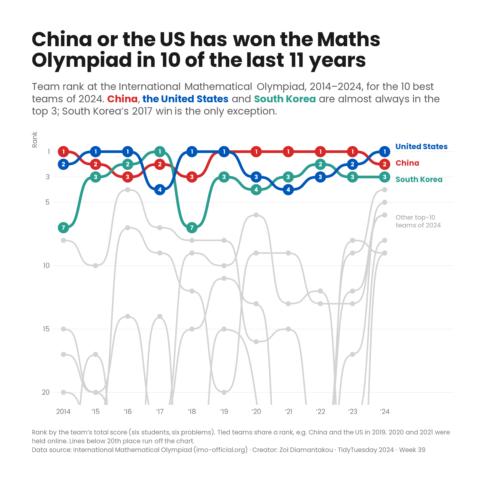</a></td><td><b>International Mathematical Olympiad (IMO) Data</b> China or the US has won the Maths Olympiad in 10 of the last 11 years. <i>Bump chart · ggbump</i></td><td><a href="https://github.com/rfordatascience/tidytuesday/tree/main/data/2024/2024-09-24">2024 · W39</a></td><td><a href="https://github.com/ZoiDiama/My-tidytuesday-projects/blob/main/Code%202024/Week%2039">code</a></td></tr>
<tr><td><a href="charts/2024_w04.png">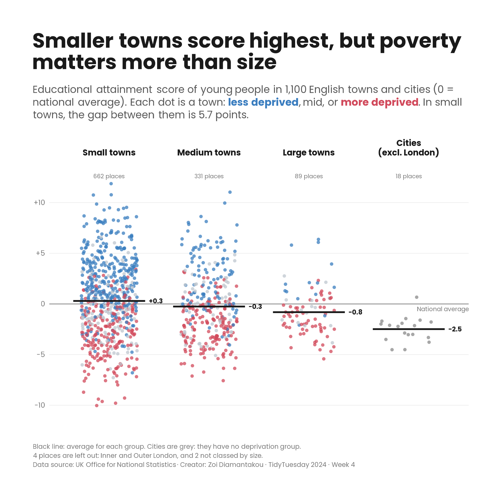</a></td><td><b>Educational attainment of young people in English towns</b> Smaller English towns score highest in education, but poverty matters more than size. <i>Beeswarm-style strip plot</i></td><td><a href="https://github.com/rfordatascience/tidytuesday/tree/main/data/2024/2024-01-23">2024 · W4</a></td><td><a href="https://github.com/ZoiDiama/My-tidytuesday-projects/blob/main/Code%202024/Week%204">code</a></td></tr>
<tr><td><a href="charts/2023_w49.png">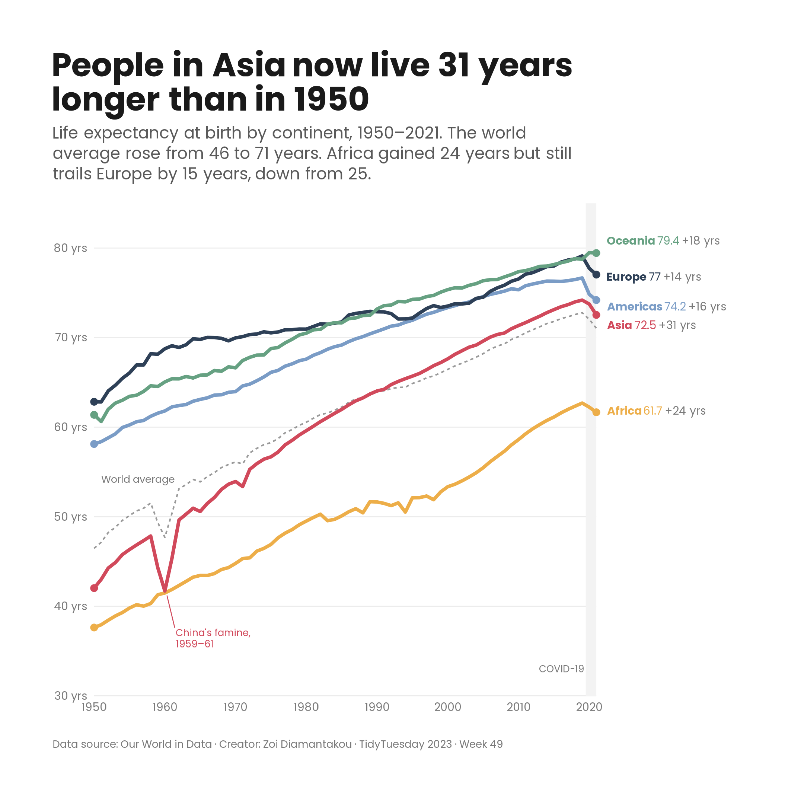</a></td><td><b>Life Expectancy</b> People in Asia now live 31 years longer than in 1950. <i>Line chart</i></td><td><a href="https://github.com/rfordatascience/tidytuesday/tree/main/data/2023/2023-12-05">2023 · W49</a></td><td><a href="https://github.com/ZoiDiama/My-tidytuesday-projects/blob/main/Code/2023/Week%2049">code</a></td></tr>
<tr><td><a href="charts/2023_w37.png">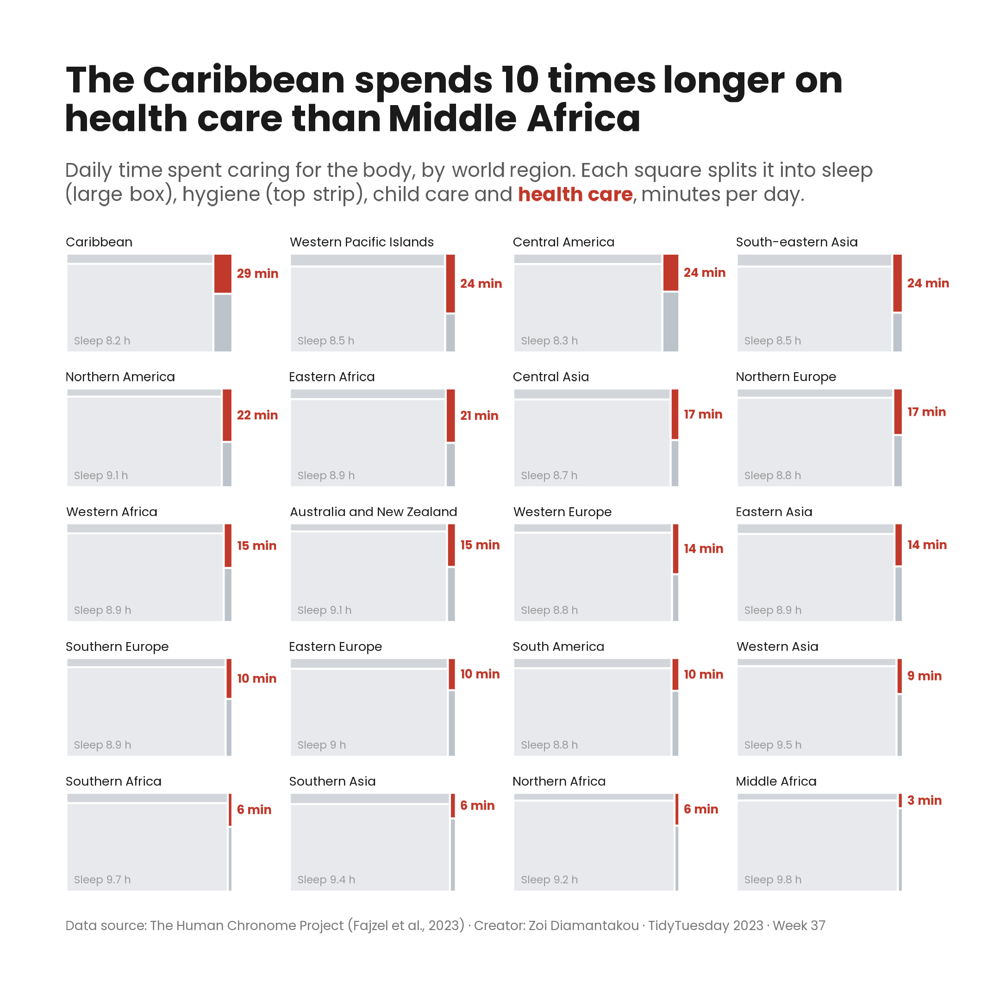</a></td><td><b>The Global Human Day</b> The Caribbean spends 10 times longer on health care than Middle Africa. <i>Small-multiple treemaps · treemapify</i></td><td><a href="https://github.com/rfordatascience/tidytuesday/tree/main/data/2023/2023-09-12">2023 · W37</a></td><td><a href="https://github.com/ZoiDiama/My-tidytuesday-projects/blob/main/Code/2023/Week%2037">code</a></td></tr>
<tr><td><a href="charts/2023_w31.png">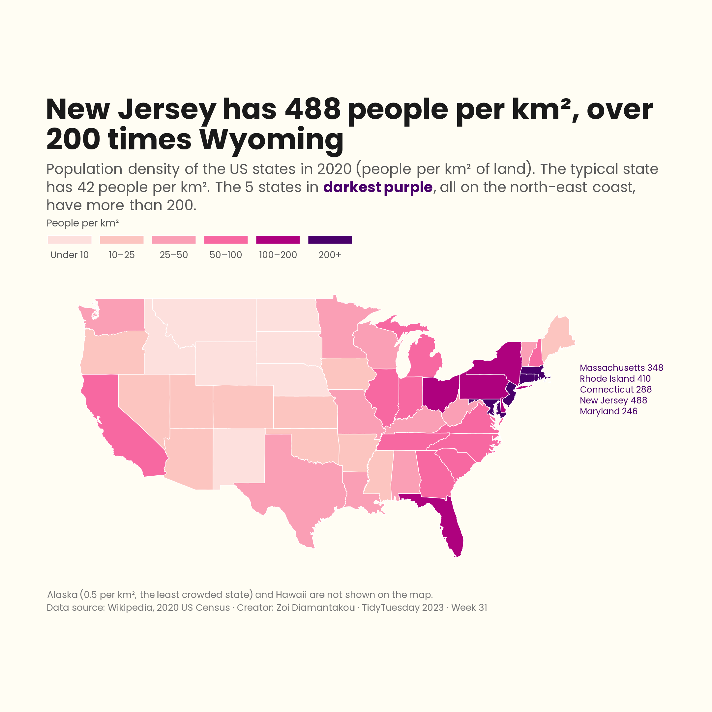</a></td><td><b>US States</b> New Jersey has 488 people per km², over 200 times Wyoming. <i>Choropleth map</i></td><td><a href="https://github.com/rfordatascience/tidytuesday/tree/main/data/2023/2023-08-01">2023 · W31</a></td><td><a href="https://github.com/ZoiDiama/My-tidytuesday-projects/blob/main/Code/2023/Week31">code</a></td></tr>
<tr><td><a href="charts/2023_w30.png">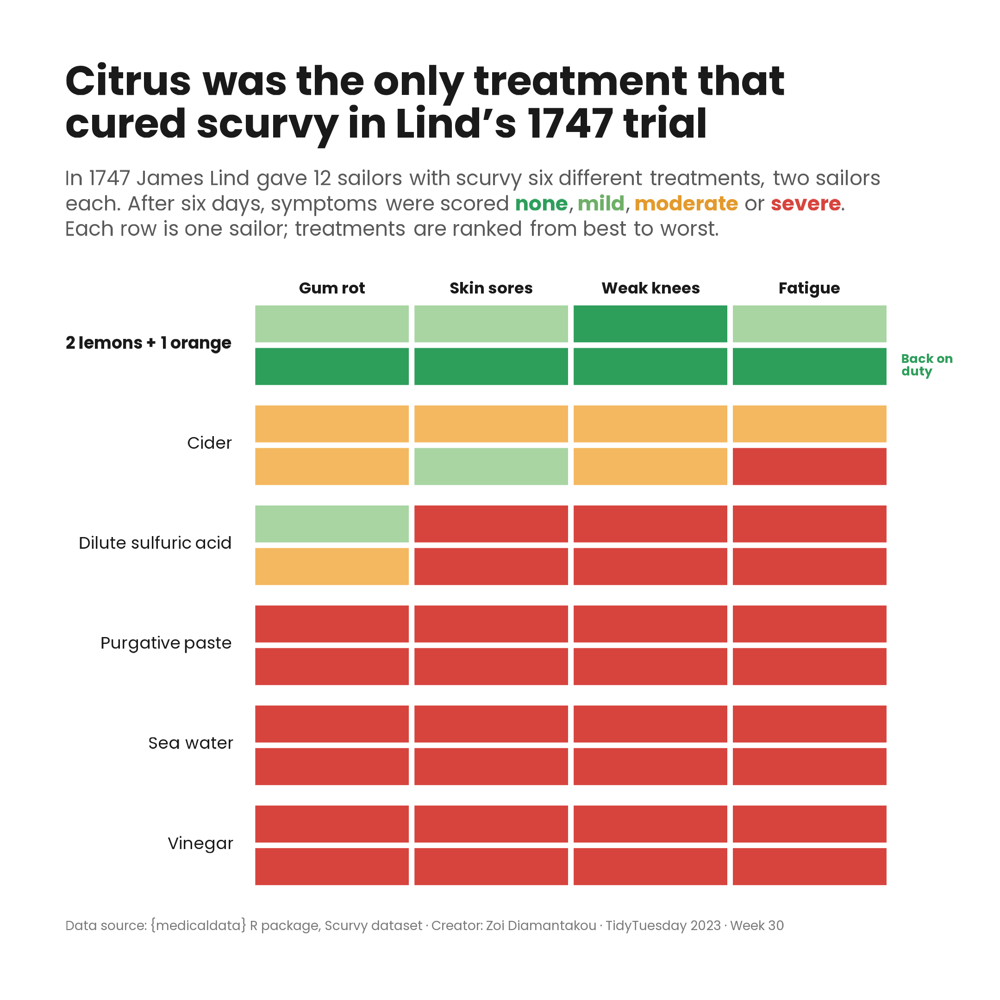</a></td><td><b>Scurvy</b> Citrus was the only treatment that cured scurvy in Lind's 1747 trial. <i>Heatmap grid</i></td><td><a href="https://github.com/rfordatascience/tidytuesday/tree/main/data/2023/2023-07-25">2023 · W30</a></td><td><a href="https://github.com/ZoiDiama/My-tidytuesday-projects/blob/main/Code/2023/Week30_Scurvy">code</a></td></tr>
</table>

[↑ Back to contents](#contents)

---

## Environment & science

Climate, nature, space and the physical world.

<table>
<tr><th width="190">Preview</th><th width="500">Chart</th><th width="120">Week</th><th width="80">Code</th></tr>
<tr><td></td><td><b>Himalayan mountaineering expeditions</b> ⭐ 8 of 16 Himalayan summits over 8,000 m saw zero climbers in 2020–2024. <i>Mountain-shaped bar chart</i></td><td><a href="https://github.com/rfordatascience/tidytuesday/tree/main/data/2025/2025-01-21">2025 · W3</a></td><td><a href="https://github.com/ZoiDiama/My-tidytuesday-projects/blob/main/Code%202025/Week%203">code</a></td></tr>
<tr><td><a href="charts/2024_w42.png">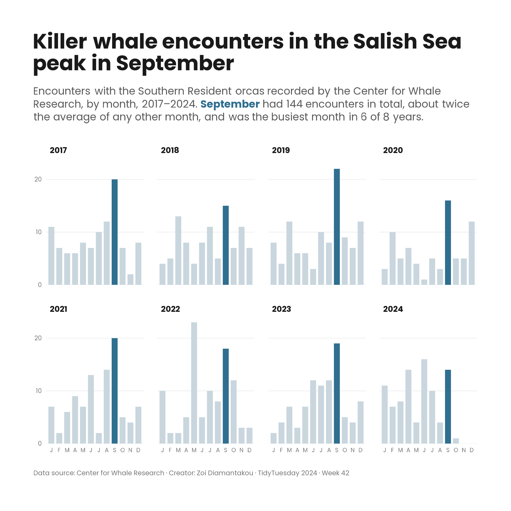</a></td><td><b>Southern Resident Killer Whale Encounters</b> Killer whale encounters in the Salish Sea peak in September. <i>Small-multiple bar charts</i></td><td><a href="https://github.com/rfordatascience/tidytuesday/tree/main/data/2024/2024-10-15">2024 · W42</a></td><td><a href="https://github.com/ZoiDiama/My-tidytuesday-projects/blob/main/Code%202024/Week%2042">code</a></td></tr>
<tr><td><a href="charts/2024_w41.png">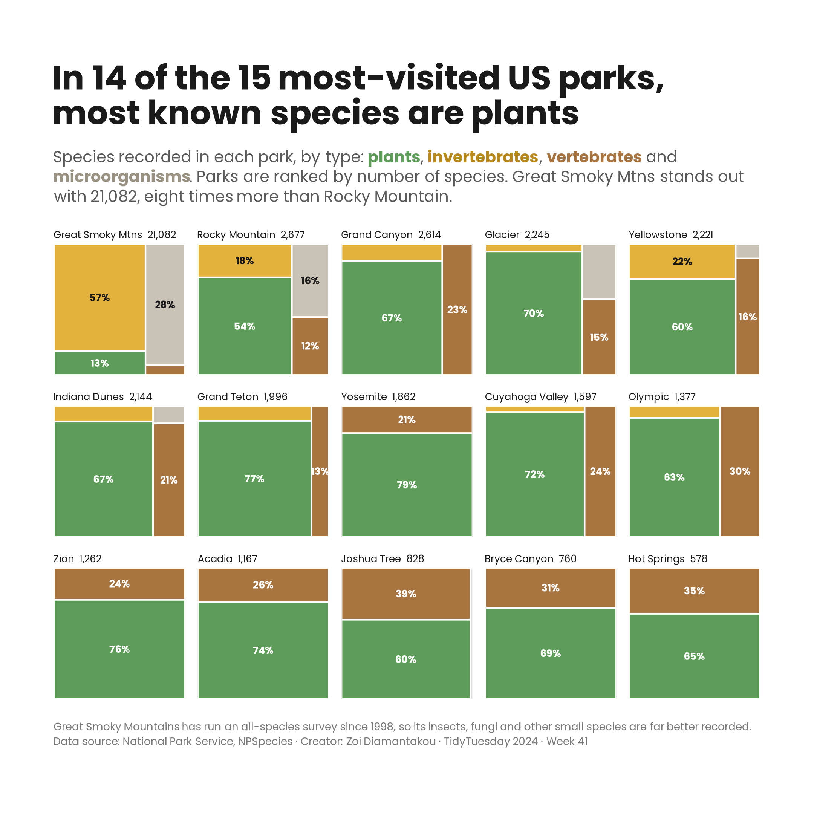</a></td><td><b>National Park Species</b> In 14 of the 15 most-visited US parks, most known species are plants. <i>Small-multiple treemaps · treemapify</i></td><td><a href="https://github.com/rfordatascience/tidytuesday/tree/main/data/2024/2024-10-08">2024 · W41</a></td><td><a href="https://github.com/ZoiDiama/My-tidytuesday-projects/blob/main/Code%202024/Week%2041">code</a></td></tr>
<tr><td><a href="charts/2024_w22.png">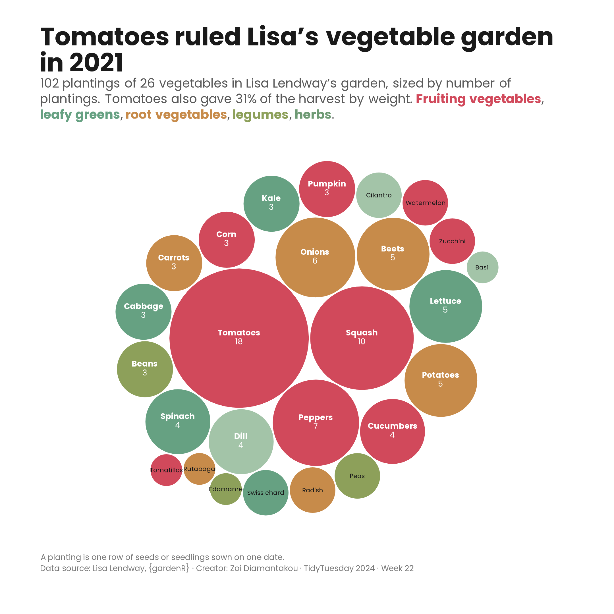</a></td><td><b>Lisa's Vegetable Garden Data</b> Tomatoes ruled Lisa's vegetable garden in 2021. <i>Bubble chart · packcircles</i></td><td><a href="https://github.com/rfordatascience/tidytuesday/tree/main/data/2024/2024-05-28">2024 · W22</a></td><td><a href="https://github.com/ZoiDiama/My-tidytuesday-projects/blob/main/Code%202024/Week%2022">code</a></td></tr>
<tr><td><a href="charts/2024_w21.png">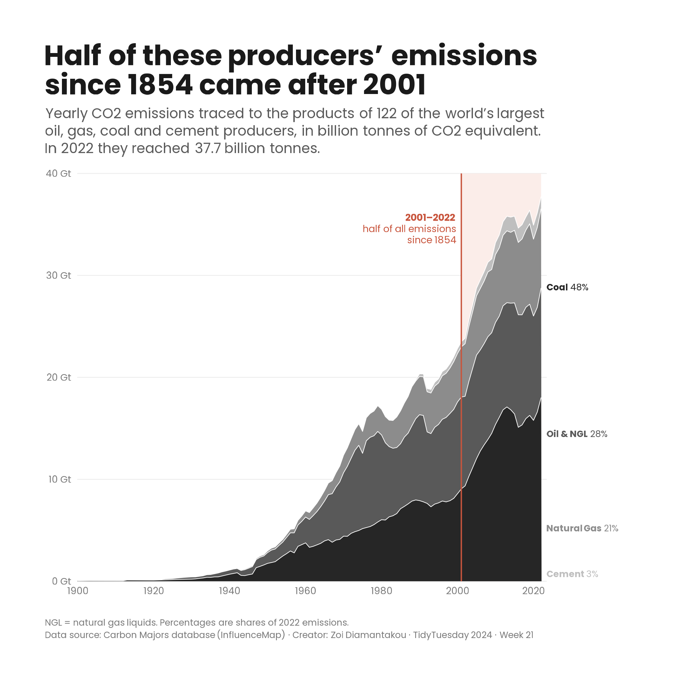</a></td><td><b>Carbon Majors Emissions Data</b> Half of the Carbon Majors' emissions since 1854 came after 2001. <i>Stacked area chart</i></td><td><a href="https://github.com/rfordatascience/tidytuesday/tree/main/data/2024/2024-05-21">2024 · W21</a></td><td><a href="https://github.com/ZoiDiama/My-tidytuesday-projects/blob/main/Code%202024/Week%2021">code</a></td></tr>
<tr><td></td><td><b>Objects Launched into Space</b> ⭐ Space got crowded fast: from 4 launches a year to more than 1,000. <i>Stacked area chart</i></td><td><a href="https://github.com/rfordatascience/tidytuesday/tree/main/data/2024/2024-04-23">2024 · W17</a></td><td><a href="https://github.com/ZoiDiama/My-tidytuesday-projects/blob/main/Code%202024/Week%2017">code</a></td></tr>
<tr><td><a href="charts/2024_w15.png">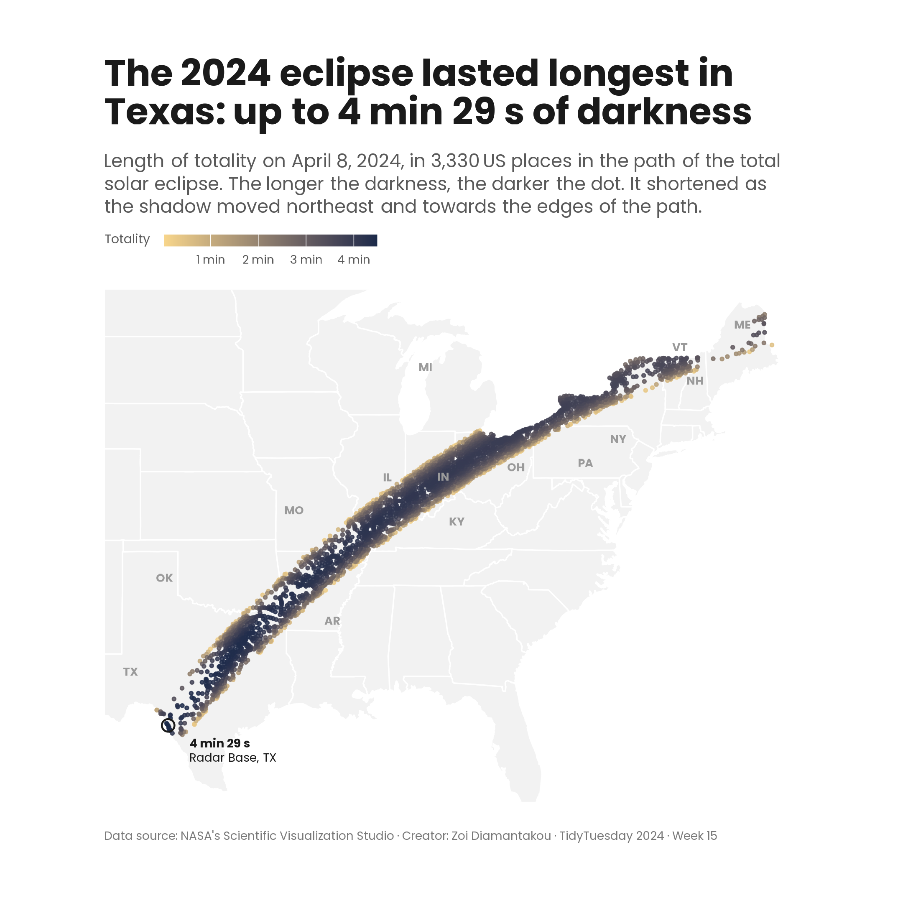</a></td><td><b>2023 & 2024 US Solar Eclipses</b> The 2024 eclipse lasted longest in Texas: up to 4 min 29 s of darkness. <i>Dot map</i></td><td><a href="https://github.com/rfordatascience/tidytuesday/tree/main/data/2024/2024-04-09">2024 · W15</a></td><td><a href="https://github.com/ZoiDiama/My-tidytuesday-projects/blob/main/Code%202024/Week%2015">code</a></td></tr>
<tr><td><a href="charts/2024_w10.png">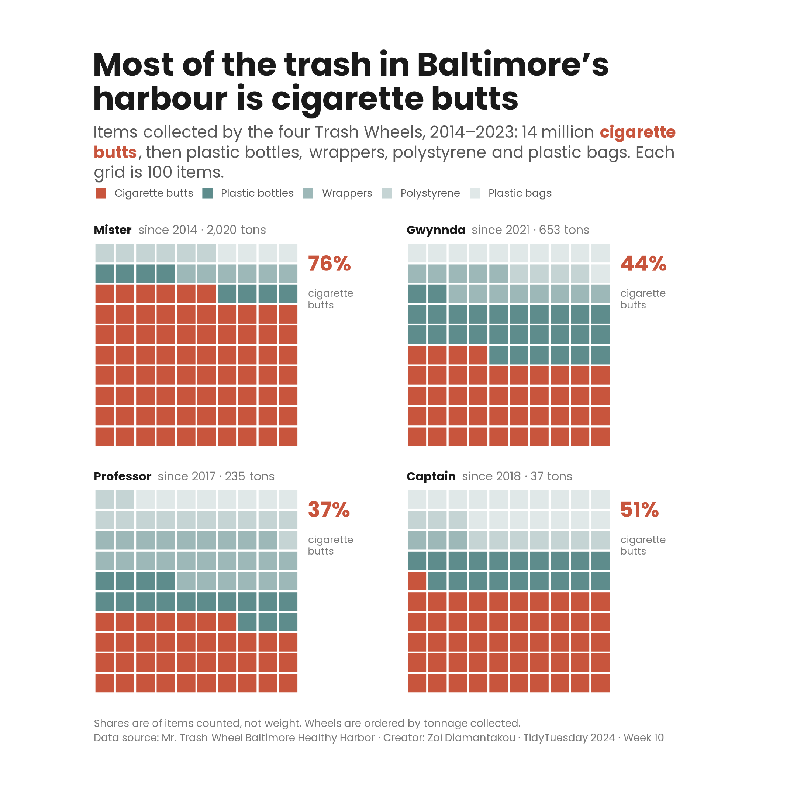</a></td><td><b>Trash Wheel Collection Data</b> Most of the trash in Baltimore's harbour is cigarette butts. <i>Waffle grids</i></td><td><a href="https://github.com/rfordatascience/tidytuesday/tree/main/data/2024/2024-03-05">2024 · W10</a></td><td><a href="https://github.com/ZoiDiama/My-tidytuesday-projects/blob/main/Code%202024/Week%2010">code</a></td></tr>
<tr><td><a href="charts/2024_w05.png">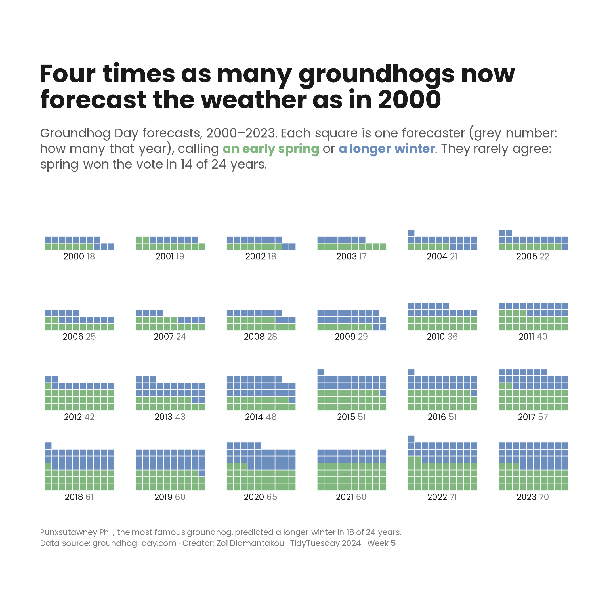</a></td><td><b>Groundhog predictions</b> Four times as many groundhogs now forecast the weather as in 2000. <i>Waffle timeline</i></td><td><a href="https://github.com/rfordatascience/tidytuesday/tree/main/data/2024/2024-01-30">2024 · W5</a></td><td><a href="https://github.com/ZoiDiama/My-tidytuesday-projects/blob/main/Code%202024/Week%205">code</a></td></tr>
<tr><td><a href="featured/2023_w28.png">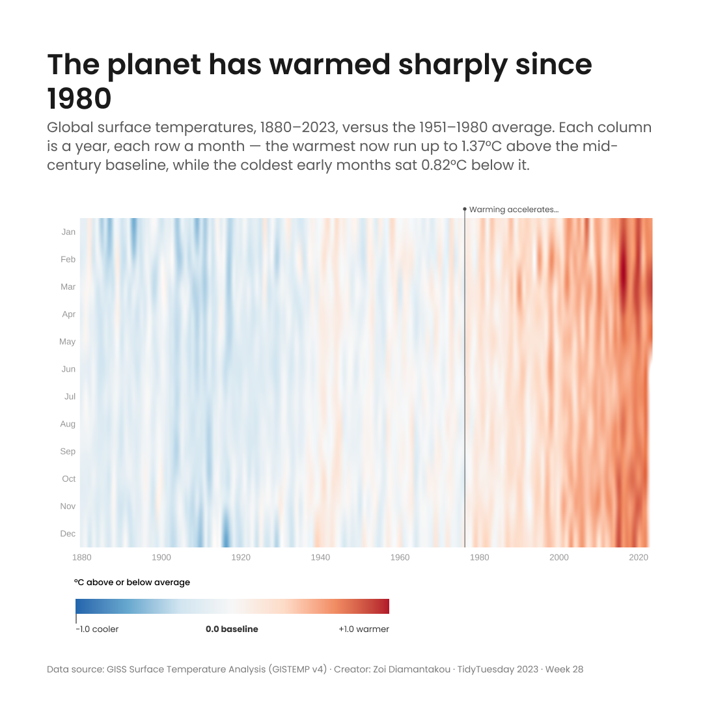</a></td><td><b>Global Surface Temperatures</b> ⭐ The planet has warmed sharply since 1980. <i>Warming-stripes heatmap</i></td><td><a href="https://github.com/rfordatascience/tidytuesday/tree/main/data/2023/2023-07-11">2023 · W28</a></td><td><a href="https://github.com/ZoiDiama/My-tidytuesday-projects/blob/main/Code/2023/Week28Global%20Surface%20Temperatures">code</a></td></tr>
</table>

[↑ Back to contents](#contents)

---

## Culture & entertainment

Books, film, TV, music and history.

<table>
<tr><th width="190">Preview</th><th width="500">Chart</th><th width="120">Week</th><th width="80">Code</th></tr>
<tr><td><a href="charts/2024_w44.png">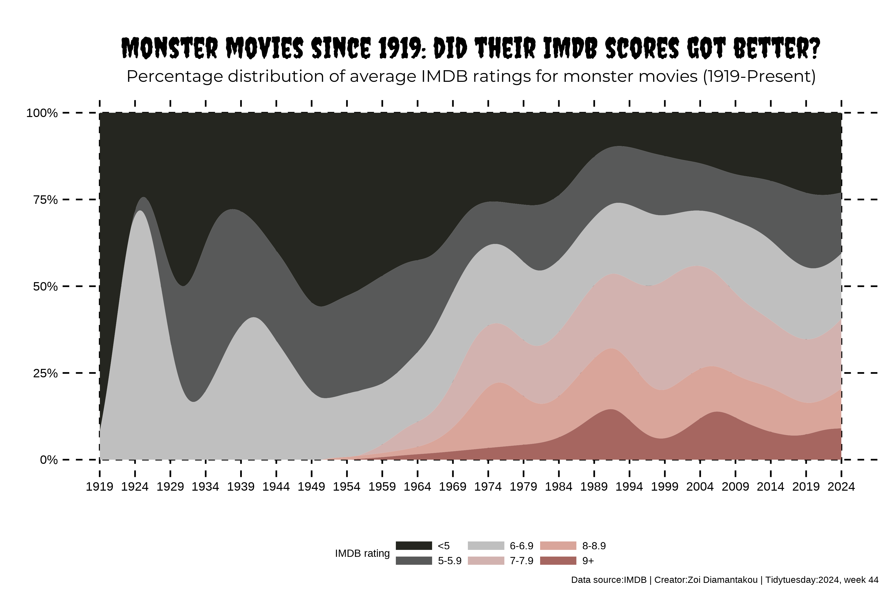</a></td><td><b>Monster Movies</b> How IMDb ratings of monster movies have shifted since 1919. <i>100% stacked area chart</i></td><td><a href="https://github.com/rfordatascience/tidytuesday/tree/main/data/2024/2024-10-29">2024 · W44</a></td><td><a href="https://github.com/ZoiDiama/My-tidytuesday-projects/blob/main/Code%202024/Week%2044">code</a></td></tr>
<tr><td><a href="featured/2024_w38.png">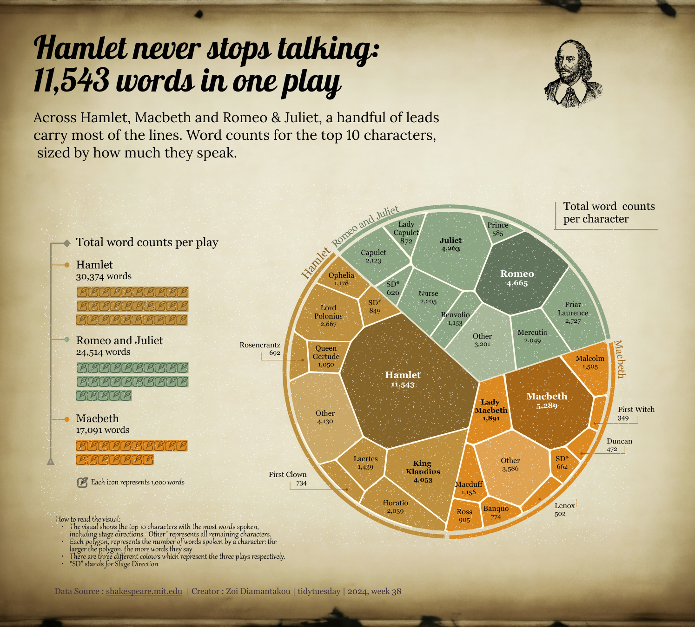</a></td><td><b>Shakespeare dialogue</b> ⭐ Hamlet never stops talking: 11,543 words in one play. <i>Voronoi treemap</i></td><td><a href="https://github.com/rfordatascience/tidytuesday/tree/main/data/2024/2024-09-17">2024 · W38</a></td><td><a href="https://github.com/ZoiDiama/My-tidytuesday-projects/blob/main/Code%202024/Week%2038">code</a></td></tr>
<tr><td><a href="charts/2024_w35.png">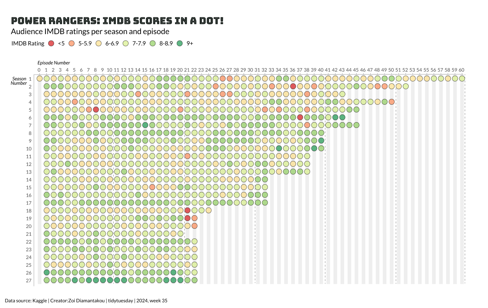</a></td><td><b>The Power Rangers Franchise</b> The IMDb rating of every Power Rangers episode, season by season. <i>Dot matrix</i></td><td><a href="https://github.com/rfordatascience/tidytuesday/tree/main/data/2024/2024-08-27">2024 · W35</a></td><td><a href="https://github.com/ZoiDiama/My-tidytuesday-projects/blob/main/Code%202024/Week%2035">code</a></td></tr>
<tr><td><a href="charts/2024_w34.png">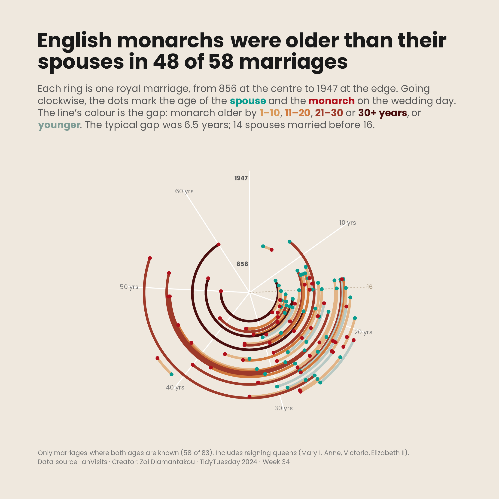</a></td><td><b>English Monarchs and Marriages</b> English monarchs were older than their spouses in 48 of 58 marriages. <i>Experimental radial dumbbell · coord_polar</i></td><td><a href="https://github.com/rfordatascience/tidytuesday/tree/main/data/2024/2024-08-20">2024 · W34</a></td><td><a href="https://github.com/ZoiDiama/My-tidytuesday-projects/blob/main/Code%202024/Week%2034">code</a></td></tr>
<tr><td><a href="charts/2024_w33.png">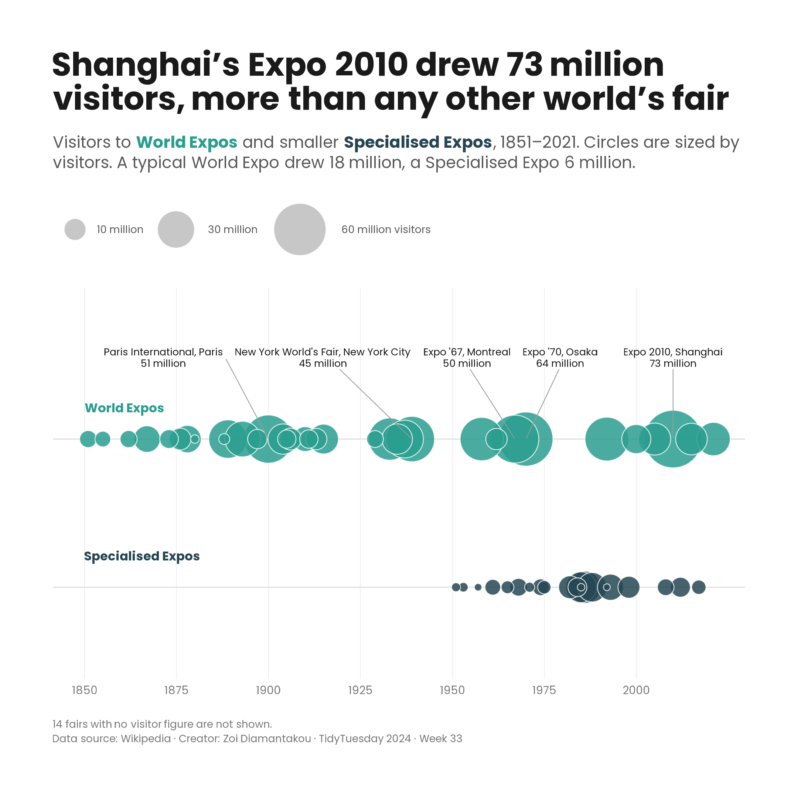</a></td><td><b>World's fairs</b> Shanghai's Expo 2010 drew 73 million visitors, more than any other world's fair. <i>Bubble timeline</i></td><td><a href="https://github.com/rfordatascience/tidytuesday/tree/main/data/2024/2024-08-13">2024 · W33</a></td><td><a href="https://github.com/ZoiDiama/My-tidytuesday-projects/blob/main/Code%202024/Week%2033">code</a></td></tr>
<tr><td><a href="charts/2024_w31.png">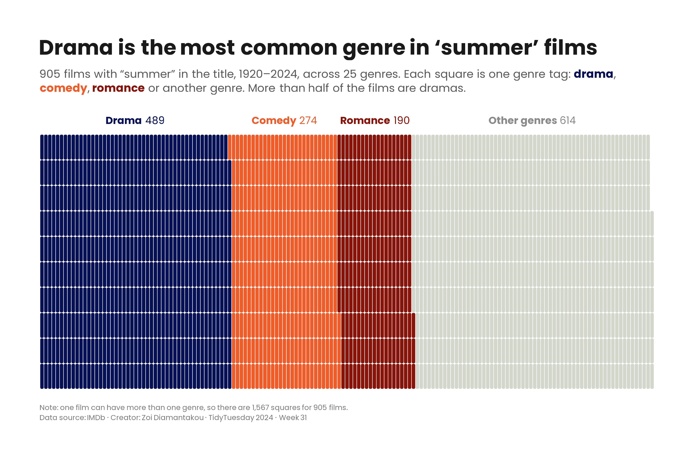</a></td><td><b>Summer Movies</b> Drama is the most common genre in films with 'summer' in the title. <i>Waffle chart · waffle</i></td><td><a href="https://github.com/rfordatascience/tidytuesday/tree/main/data/2024/2024-07-30">2024 · W31</a></td><td><a href="https://github.com/ZoiDiama/My-tidytuesday-projects/blob/main/Code%202024/Week%2031">code</a></td></tr>
<tr><td><a href="charts/2024_w30.png">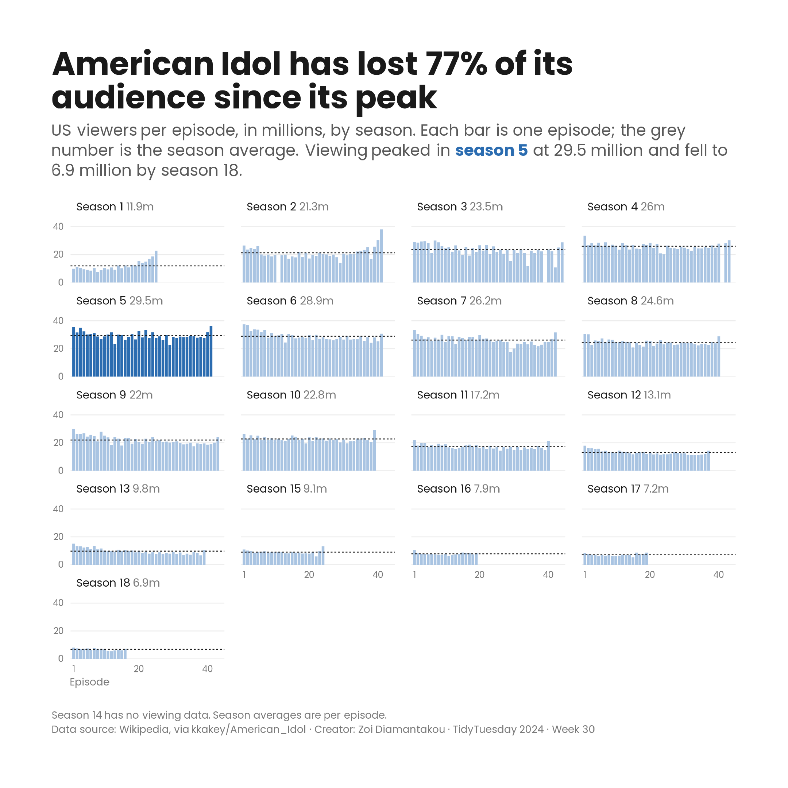</a></td><td><b>American Idol</b> American Idol has lost 77% of its audience since its peak. <i>Small-multiple bar charts</i></td><td><a href="https://github.com/rfordatascience/tidytuesday/tree/main/data/2024/2024-07-23">2024 · W30</a></td><td><a href="https://github.com/ZoiDiama/My-tidytuesday-projects/blob/main/Code%202024/Week%2030">code</a></td></tr>
<tr><td><a href="charts/2024_w6.png">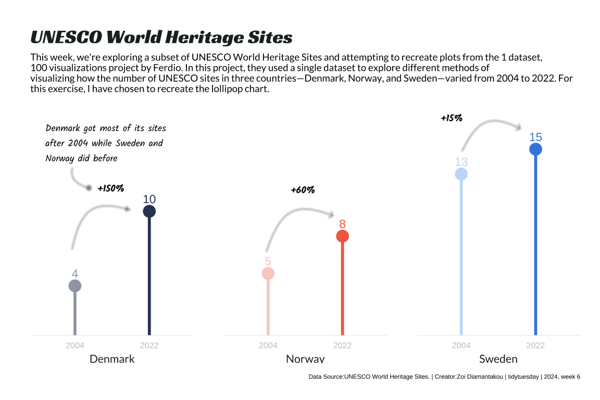</a></td><td><b>UNESCO World Heritage sites</b> UNESCO World Heritage sites in Denmark, Norway and Sweden, 2004 vs 2022: a recreation of Ferdio's lollipop chart. <i>Lollipop chart</i></td><td><a href="https://github.com/rfordatascience/tidytuesday/tree/main/data/2024/2024-02-06">2024 · W6</a></td><td><a href="https://github.com/ZoiDiama/My-tidytuesday-projects/blob/main/Code%202024/Week%206">code</a></td></tr>
<tr><td></td><td><b>Holiday episodes</b> Christmas-themed TV episodes on IMDb. <i>Dot chart</i></td><td><a href="https://github.com/rfordatascience/tidytuesday/tree/main/data/2023/2023-12-19">2023 · W51</a></td><td><a href="https://github.com/ZoiDiama/My-tidytuesday-projects/blob/f9b056a141896d82d1989c40e32df7c31e016440/Code/2023/Week%2051#L1-L113">code</a></td></tr>
<tr><td></td><td><b>Holiday movies</b> The genres of holiday movies on IMDb. <i>Word cloud</i></td><td><a href="https://github.com/rfordatascience/tidytuesday/tree/main/data/2023/2023-12-12">2023 · W50</a></td><td><a href="https://github.com/ZoiDiama/My-tidytuesday-projects/blob/6da4d041fa6465cb4babbfcef87baacf722c6526/Code/2023/Week%2050#L1-L70">code</a></td></tr>
<tr><td><a href="charts/2023_w48.png">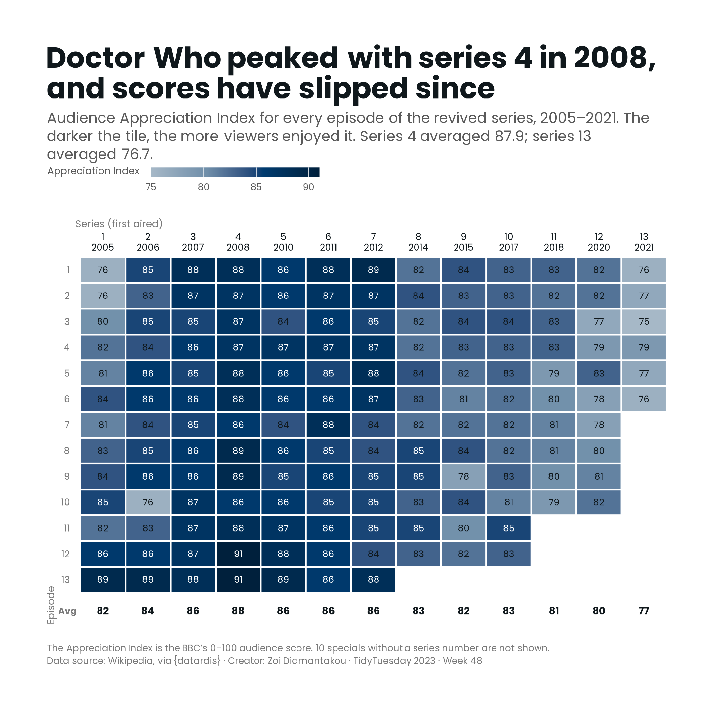</a></td><td><b>Doctor Who Episodes</b> Doctor Who peaked with series 4 in 2008, and scores have slipped since. <i>Heatmap</i></td><td><a href="https://github.com/rfordatascience/tidytuesday/tree/main/data/2023/2023-11-28">2023 · W48</a></td><td><a href="https://github.com/ZoiDiama/My-tidytuesday-projects/blob/main/Code/2023/Week%2048">code</a></td></tr>
<tr><td><a href="charts/2023_w44.png">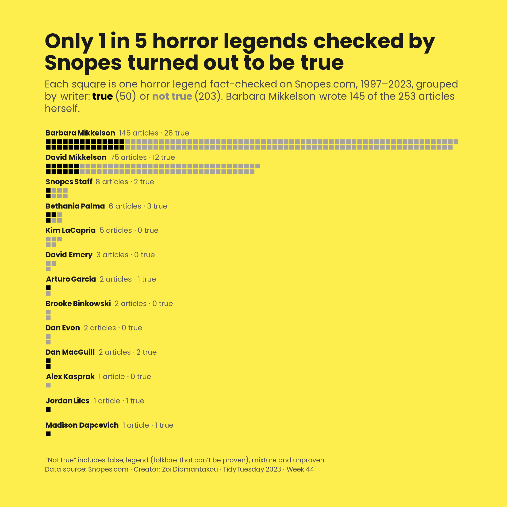</a></td><td><b>Horror Legends</b> Only 1 in 5 horror legends checked by Snopes turned out to be true. <i>Waffle chart</i></td><td><a href="https://github.com/rfordatascience/tidytuesday/tree/main/data/2023/2023-10-31">2023 · W44</a></td><td><a href="https://github.com/ZoiDiama/My-tidytuesday-projects/blob/main/Code/2023/Week_44">code</a></td></tr>
<tr><td><a href="charts/2023_w42.png">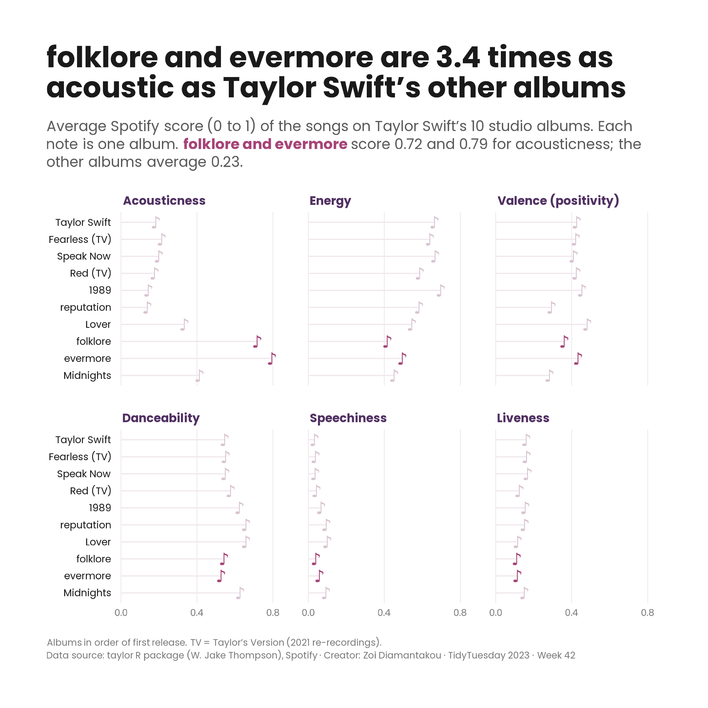</a></td><td><b>Taylor Swift songs</b> folklore and evermore are 3.4 times as acoustic as Taylor Swift's other albums. <i>Small-multiple dot plot</i></td><td><a href="https://github.com/rfordatascience/tidytuesday/tree/main/data/2023/2023-10-17">2023 · W42</a></td><td><a href="https://github.com/ZoiDiama/My-tidytuesday-projects/blob/main/Code/2023/Week%2042">code</a></td></tr>
<tr><td><a href="charts/2023_w41.png">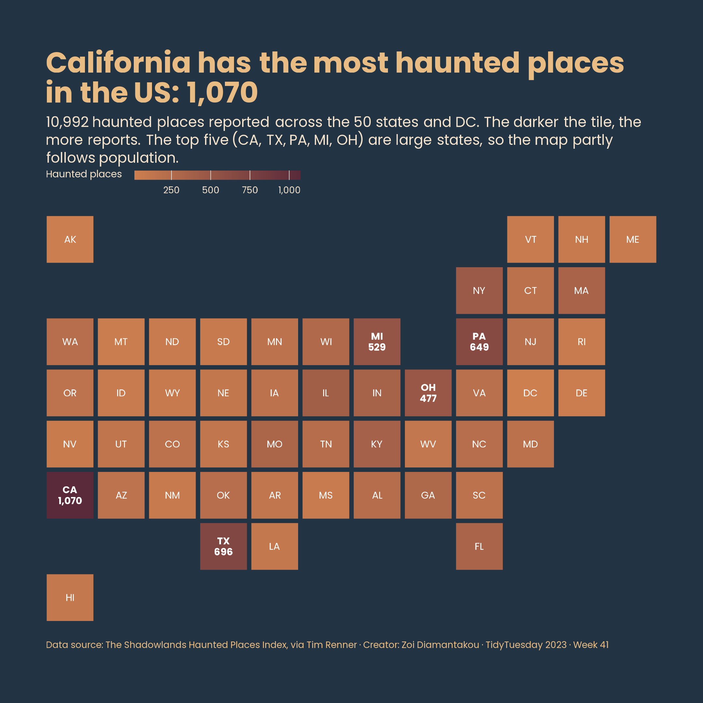</a></td><td><b>Haunted Places in the United States</b> California has the most haunted places in the US: 1,070. <i>Tile grid map</i></td><td><a href="https://github.com/rfordatascience/tidytuesday/tree/main/data/2023/2023-10-10">2023 · W41</a></td><td><a href="https://github.com/ZoiDiama/My-tidytuesday-projects/blob/main/Code/2023/Week%2041">code</a></td></tr>
<tr><td><a href="charts/2023_w39.png">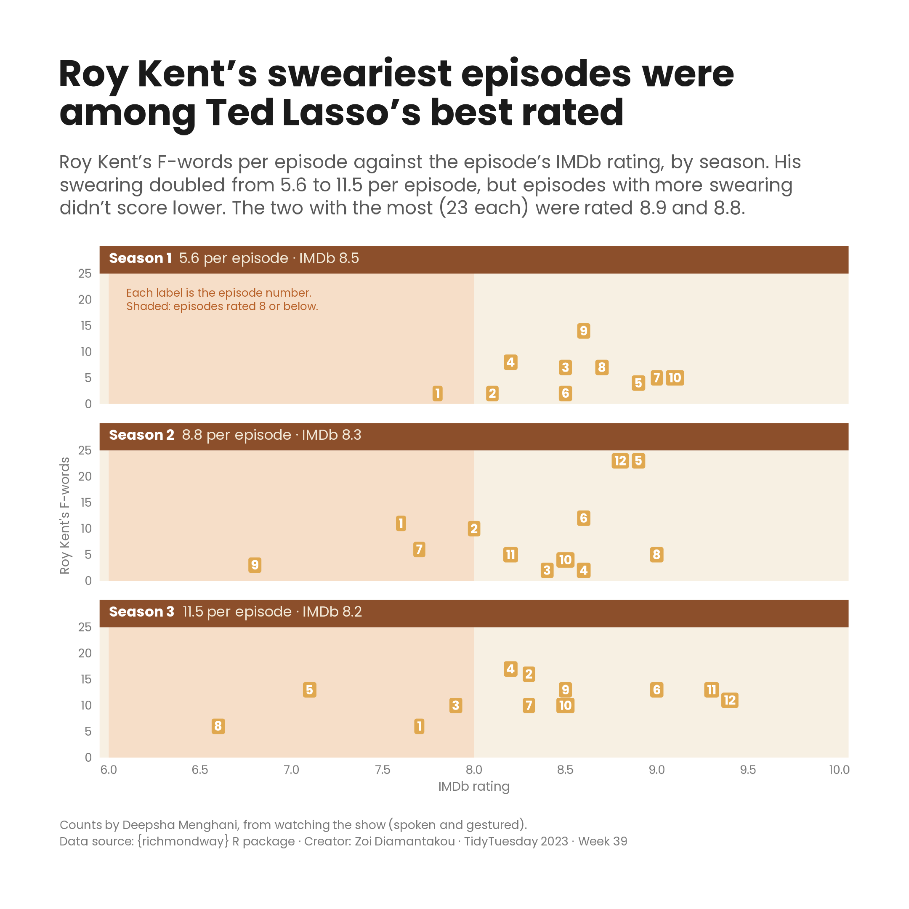</a></td><td><b>Roy Kent's swear count</b> Roy Kent's sweariest episodes were among Ted Lasso's best rated. <i>Faceted scatter plot</i></td><td><a href="https://github.com/rfordatascience/tidytuesday/tree/main/data/2023/2023-09-26">2023 · W39</a></td><td><a href="https://github.com/ZoiDiama/My-tidytuesday-projects/blob/main/Code/2023/Week%2039">code</a></td></tr>
<tr><td><a href="charts/2023_w32.png">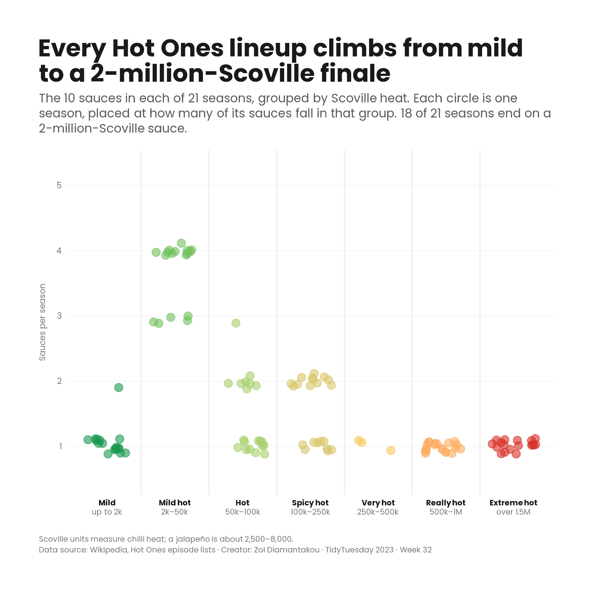</a></td><td><b>Hot Ones Episodes</b> Every Hot Ones lineup climbs from mild to a 2-million-Scoville finale. <i>Dot plot</i></td><td><a href="https://github.com/rfordatascience/tidytuesday/tree/main/data/2023/2023-08-08">2023 · W32</a></td><td><a href="https://github.com/ZoiDiama/My-tidytuesday-projects/blob/main/Code/2023/Week32">code</a></td></tr>
</table>

[↑ Back to contents](#contents)

---

## Sport, food & everyday life

Games, competitions, food and the calendar.

<table>
<tr><th width="190">Preview</th><th width="500">Chart</th><th width="120">Week</th><th width="80">Code</th></tr>
<tr><td><a href="charts/2024_w40.png">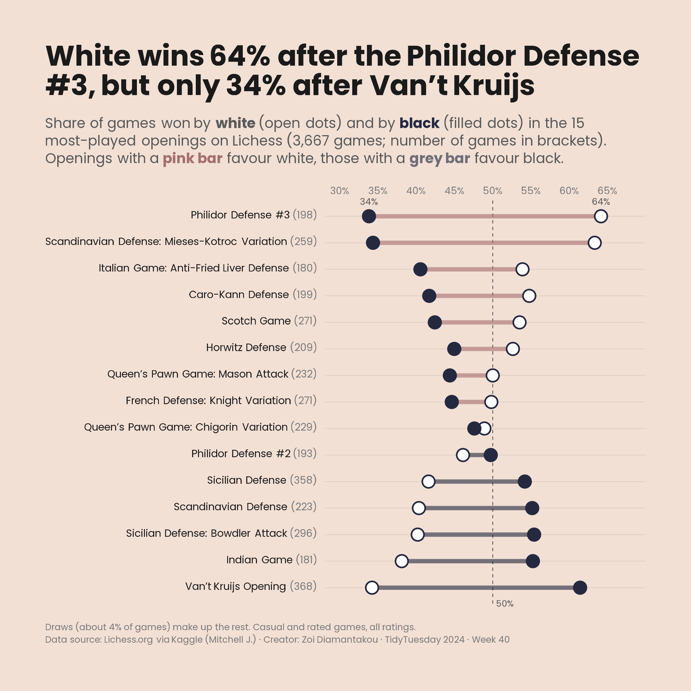</a></td><td><b>Chess Game Dataset (Lichess)</b> White wins 64% after the Philidor Defense #3, but only 34% after Van't Kruijs. <i>Dumbbell chart</i></td><td><a href="https://github.com/rfordatascience/tidytuesday/tree/main/data/2024/2024-10-01">2024 · W40</a></td><td><a href="https://github.com/ZoiDiama/My-tidytuesday-projects/blob/main/Code%202024/Week%2040">code</a></td></tr>
<tr><td><a href="charts/2024_w32.png">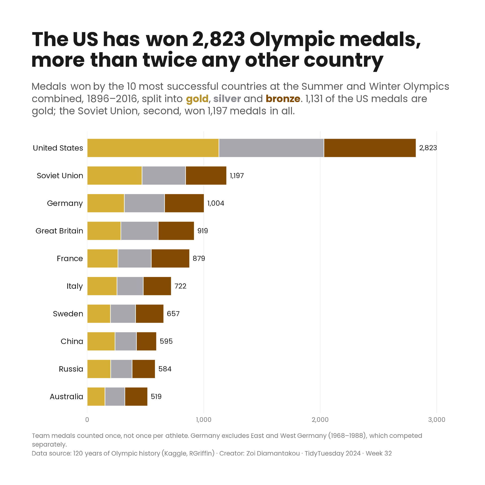</a></td><td><b>Olympic Medals</b> The US has won 2,823 Olympic medals, more than twice any other country. <i>Stacked bar chart</i></td><td><a href="https://github.com/rfordatascience/tidytuesday/tree/main/data/2024/2024-08-06">2024 · W32</a></td><td><a href="https://github.com/ZoiDiama/My-tidytuesday-projects/blob/main/Code%202024/Week%2032">code</a></td></tr>
<tr><td><a href="charts/2024_w29.png">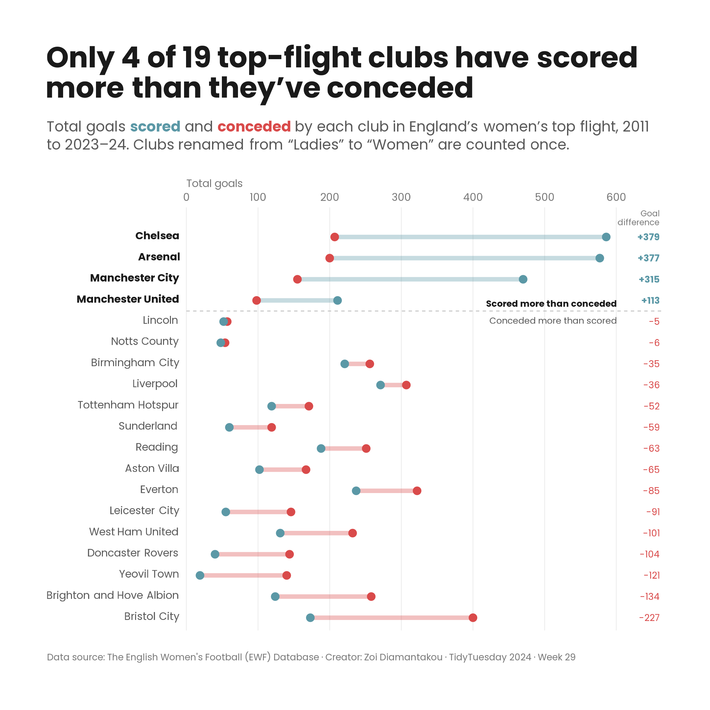</a></td><td><b>English Women's Football</b> Only 4 of 19 top-flight clubs in English women's football have scored more than they've conceded. <i>Dumbbell chart</i></td><td><a href="https://github.com/rfordatascience/tidytuesday/tree/main/data/2024/2024-07-16">2024 · W29</a></td><td><a href="https://github.com/ZoiDiama/My-tidytuesday-projects/blob/main/Code%202024/Week%2029">code</a></td></tr>
<tr><td><a href="charts/2024_w25.png">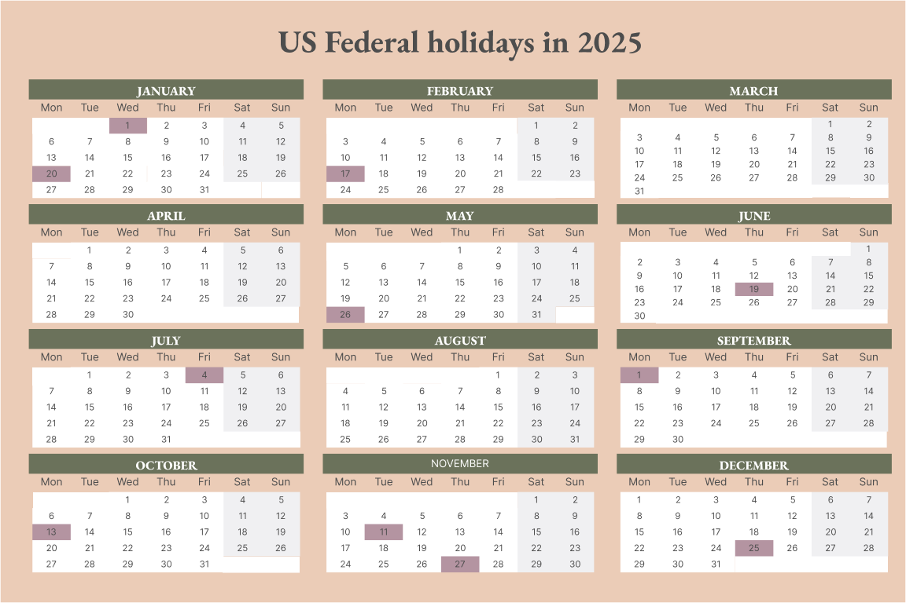</a></td><td><b>US federal holidays</b> Every US federal holiday on a 2025 calendar. <i>Calendar grid</i></td><td><a href="https://github.com/rfordatascience/tidytuesday/tree/main/data/2024/2024-06-18">2024 · W25</a></td><td><a href="https://github.com/ZoiDiama/My-tidytuesday-projects/tree/main/Code%202024">code</a></td></tr>
<tr><td><a href="charts/2024_w23.png">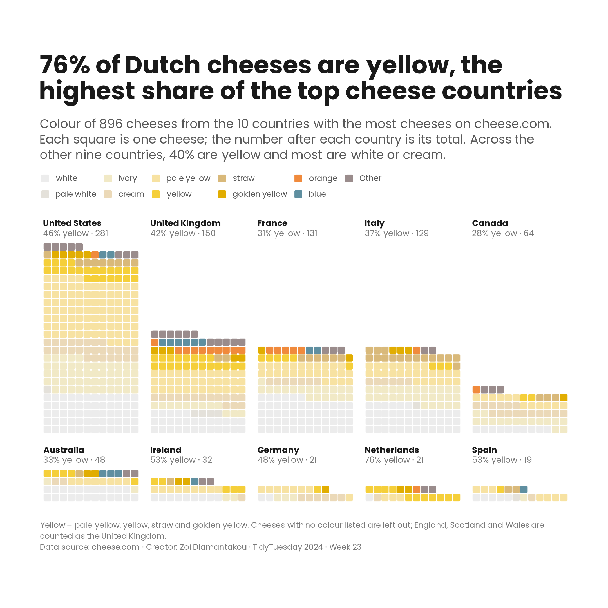</a></td><td><b>Cheese</b> 76% of Dutch cheeses are yellow, the highest share of the top cheese countries. <i>Small-multiple waffle charts · waffle</i></td><td><a href="https://github.com/rfordatascience/tidytuesday/tree/main/data/2024/2024-06-04">2024 · W23</a></td><td><a href="https://github.com/ZoiDiama/My-tidytuesday-projects/blob/main/Code%202024/Week%2023">code</a></td></tr>
<tr><td><a href="charts/2024_w20.png">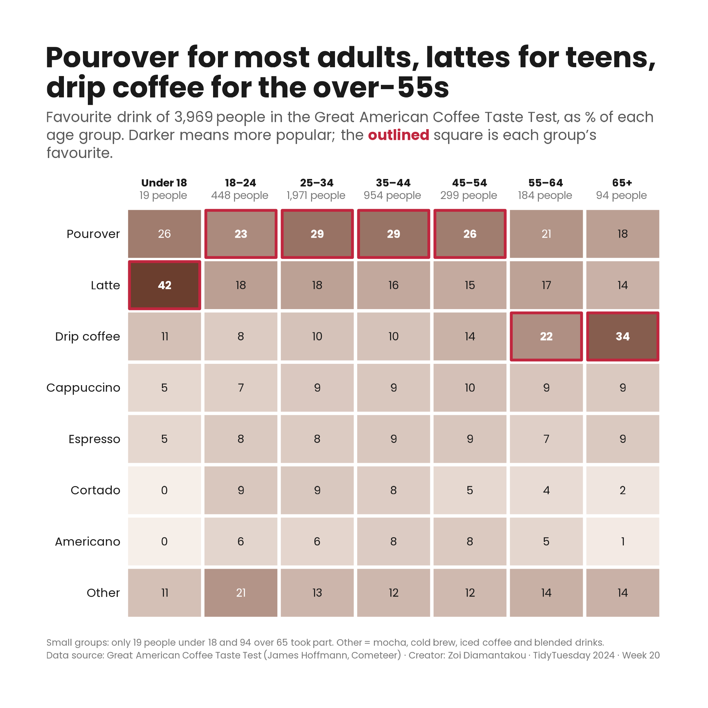</a></td><td><b>The Great American Coffee Taste Test</b> Pourover for most adults, lattes for teens, drip coffee for the over-55s. <i>Heatmap</i></td><td><a href="https://github.com/rfordatascience/tidytuesday/tree/main/data/2024/2024-05-14">2024 · W20</a></td><td><a href="https://github.com/ZoiDiama/My-tidytuesday-projects/blob/main/Code%202024/Week%2020">code</a></td></tr>
<tr><td><a href="charts/2024_w09.png">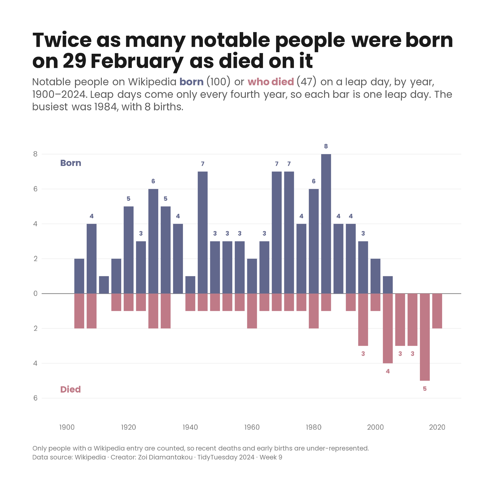</a></td><td><b>Leap Day</b> Twice as many notable people were born on 29 February as died on it. <i>Mirrored bar chart</i></td><td><a href="https://github.com/rfordatascience/tidytuesday/tree/main/data/2024/2024-02-27">2024 · W9</a></td><td><a href="https://github.com/ZoiDiama/My-tidytuesday-projects/blob/main/Code%202024/Week%209">code</a></td></tr>
<tr><td><a href="charts/2024_w07.png">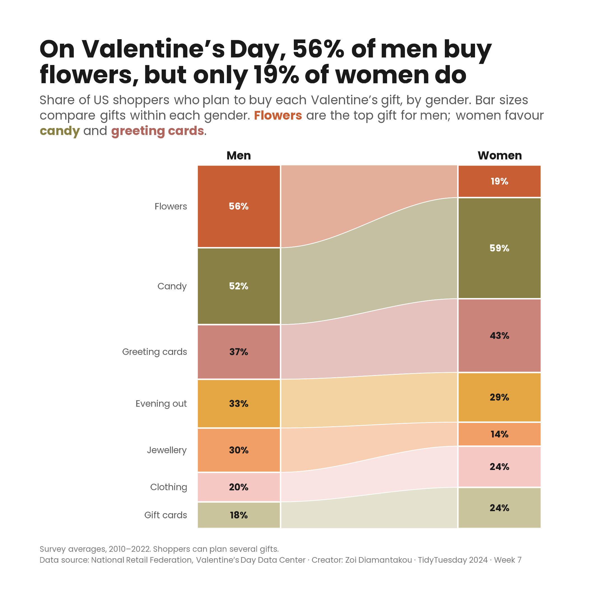</a></td><td><b>Valentine's Day Consumer Data</b> On Valentine's Day, 56% of men buy flowers, but only 19% of women do. <i>Alluvial chart · ggalluvial</i></td><td><a href="https://github.com/rfordatascience/tidytuesday/tree/main/data/2024/2024-02-13">2024 · W7</a></td><td><a href="https://github.com/ZoiDiama/My-tidytuesday-projects/blob/main/Code%202024/Week%207">code</a></td></tr>
<tr><td></td><td><b>Canadian Hockey Players</b> International NHL goalies stand 5 cm taller than Canadian ones. <i>Ridgeline plot · ggridges</i></td><td><a href="https://github.com/rfordatascience/tidytuesday/tree/main/data/2024/2024-01-09">2024 · W2</a></td><td><a href="https://github.com/ZoiDiama/My-tidytuesday-projects/blob/main/Code%202024/Week%202">code</a></td></tr>
<tr><td></td><td><b>Diwali Sales Data</b> Food is 32% of Diwali spending, twice as much as clothing. <i>Alluvial chart · ggalluvial</i></td><td><a href="https://github.com/rfordatascience/tidytuesday/tree/main/data/2023/2023-11-14">2023 · W46</a></td><td><a href="https://github.com/ZoiDiama/My-tidytuesday-projects/blob/main/Code/2023/Week_46">code</a></td></tr>
<tr><td></td><td><b>Spam emails</b> 38% of spam emails say "money"; only 2% of other emails do. <i>Dumbbell chart</i></td><td><a href="https://github.com/rfordatascience/tidytuesday/tree/main/data/2023/2023-08-15">2023 · W33</a></td><td><a href="https://github.com/ZoiDiama/My-tidytuesday-projects/blob/main/Code/2023/Week%2033">code</a></td></tr>
</table>

[↑ Back to contents](#contents)

---

## R & the data community

Charts about the tools and people behind open data.

<table>
<tr><th width="190">Preview</th><th width="500">Chart</th><th width="120">Week</th><th width="80">Code</th></tr>
<tr><td></td><td><b>posit::conf talks</b> Posit's own staff were 30 of the 116 speakers at posit::conf 2023. <i>Radial bar chart · coord_polar, patchwork</i></td><td><a href="https://github.com/rfordatascience/tidytuesday/tree/main/data/2025/2025-01-14">2025 · W2</a></td><td><a href="https://github.com/ZoiDiama/My-tidytuesday-projects/blob/main/Code%202025/Week%202">code</a></td></tr>
<tr><td></td><td><b>Stack Overflow Annual Developer Survey 2024</b> Developers with 20+ years' experience earn 2.8× what beginners do. <i>Jittered strip plot</i></td><td><a href="https://github.com/rfordatascience/tidytuesday/tree/main/data/2024/2024-09-03">2024 · W36</a></td><td><a href="https://github.com/ZoiDiama/My-tidytuesday-projects/blob/main/Code%202024/Week%2036">code</a></td></tr>
<tr><td></td><td><b>David Robinson's TidyTuesday Functions</b> David Robinson used aes() 1,033 times in his TidyTuesday code. <i>Circle packing · packcircles</i></td><td><a href="https://github.com/rfordatascience/tidytuesday/tree/main/data/2024/2024-07-09">2024 · W28</a></td><td><a href="https://github.com/ZoiDiama/My-tidytuesday-projects/blob/main/Code%202024/Week%2028">code</a></td></tr>
<tr><td></td><td><b>TidyTuesday Datasets</b> Only 5 of 306 TidyTuesday weeks came with more than a million rows of data. <i>Calendar heatmap</i></td><td><a href="https://github.com/rfordatascience/tidytuesday/tree/main/data/2024/2024-07-02">2024 · W27</a></td><td><a href="https://github.com/ZoiDiama/My-tidytuesday-projects/blob/main/Code%202024/Week%2027">code</a></td></tr>
<tr><td></td><td><b>R Consortium ISC Grants</b> Fall grants average $14,600, spring grants $13,200: timing barely matters. <i>Bubbles on a line</i></td><td><a href="https://github.com/rfordatascience/tidytuesday/tree/main/data/2024/2024-02-20">2024 · W8</a></td><td><a href="https://github.com/ZoiDiama/My-tidytuesday-projects/blob/main/Code%202024/Week%208">code</a></td></tr>
<tr><td></td><td><b>Structure of R packages</b> How the structure of R packages has changed over time. <i>Streamgraph · ggstream</i></td><td><a href="https://github.com/rfordatascience/tidytuesday/tree/main/data/2023/2023-12-26">2023 · W52</a></td><td><a href="https://github.com/ZoiDiama/My-tidytuesday-projects/blob/main/Code/2023/Week%2052">code</a></td></tr>
<tr><td></td><td><b>R-Ladies Chapter Events</b> R-Ladies events peaked at 920 in 2020, then fell to 444 by 2022. <i>Waffle chart</i></td><td><a href="https://github.com/rfordatascience/tidytuesday/tree/main/data/2023/2023-11-21">2023 · W47</a></td><td><a href="https://github.com/ZoiDiama/My-tidytuesday-projects/blob/main/Code/2023/Week_47">code</a></td></tr>
</table>

[↑ Back to contents](#contents)

---

## By year

| Year | Charts | Focus |
|---|---|---|
| 2023 | 23 | My first year: learning ggplot2 and trying different chart types |
| 2024 | 39 | More attention to typography, colour and final design in Figma |
| 2025 | 5 | Headline-first charts: every title states the finding |
